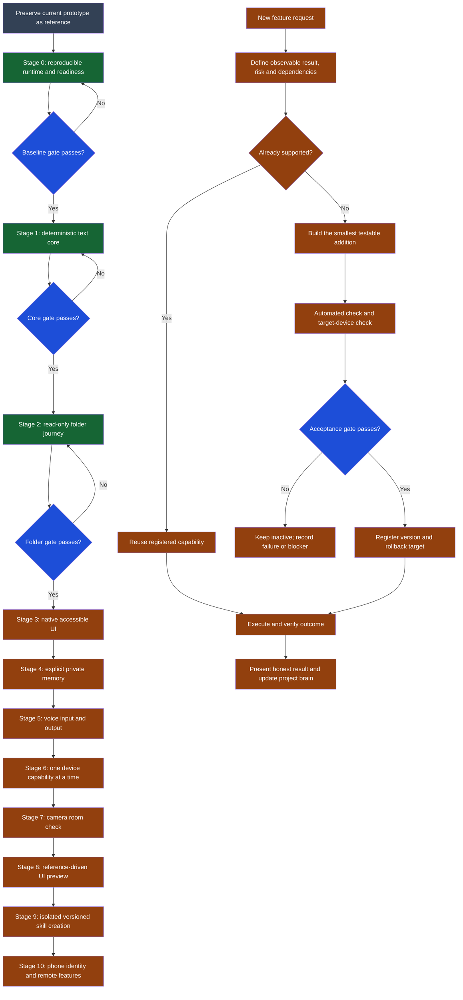

# LYA rebuild plan

Created: 2026-09-12

> **Refined first milestone:** `LYA_FOUNDATION_DECISIONS.md` defines the chosen
> native Windows stack and the owner-visible wake → face → person-session journey.
> Its build ordering takes precedence where this earlier plan differs.

## Decision

Build a new verified core beside the current prototype. Keep the existing files as
reference until the replacement reaches its acceptance gates. Do not delete or
silently reuse a legacy feature merely because its file exists.

The first useful release is deliberately small:

> LYA starts reliably, accepts typed commands, explains what it can do, answers
> deterministic local questions, opens a read-only folder view, cancels work, and
> reports failures honestly.

Voice, camera, phone approval, cloud sync, autonomous skill creation, biometrics,
and broad device control enter only after that core works on the owner's laptop.

## Rules for every capability

1. A capability has one owner-visible purpose and a concrete example.
2. Its dependencies and permission level are known before implementation.
3. It has one smallest meaningful automated check.
4. It is manually exercised in the actual target environment when hardware or UI
   is involved.
5. It reports success only after verifying the outcome.
6. It has a failure path and cancellation behavior.
7. It is marked `working` only when the acceptance gate passes. Other allowed
   states are `planned`, `building`, `blocked`, `failed`, and `retired`.
8. Generated code cannot modify permissions, credentials, the updater, or its own
   acceptance evidence.

## Clean architecture

Keep one command path:

`input -> normalize -> match registered capability -> authorize -> execute -> verify -> present -> record safe outcome`

The command registry is the source of truth. Each registered capability declares:

- name and example phrases;
- risk level and required permission;
- dependency/readiness check;
- execute and verify functions;
- cancellation support;
- version and rollback target.

Begin with Python's standard library. Add one dependency only when a current
accepted milestone requires it. Keep secrets and personal observations outside
the project ledger.

## Build stages

### Stage 0 — Preserve and measure the baseline

Deliverables:

- Keep the present prototype unchanged as reference.
- Create the new core in a separate directory only when implementation starts.
- Record the supported Windows and Python versions.
- Add a readiness command that reports available and missing dependencies without
  creating keys, opening sensors, or changing the machine.

Gate:

- A clean checkout/setup can run the readiness command and deterministic tests
  using one documented command.

### Stage 1 — Deterministic text core

Capabilities: `help`, `status`, date/time, `stop`, and structured errors.

Requirements:

- One queue and one worker.
- Exact capability matching; unknown commands do not execute shell text.
- Cancellation state is observable and tested.
- Status is derived from readiness checks, not hard-coded claims.

Gate:

- Twenty consecutive start-command-stop cycles complete without a crash.
- Unknown and malformed commands have no external side effects.
- Automated checks pass from the documented environment.

### Stage 2 — Read-only folder journey

Capabilities: list the approved root, open a shown folder, previous/next page,
back, inspect file metadata, and stop.

Requirements:

- Stay inside an explicitly approved root after path and symlink resolution.
- Never execute, modify, upload, or recursively scan files.
- The same command contract works through text first and UI second.

Gate:

- Automated escape/paging tests pass.
- On the owner's laptop, the complete folder journey works five times, including
  an inaccessible folder and cancellation.

### Stage 3 — Native accessible interface

Capabilities: orb/window, typed command box, result panel, folder panel, keyboard
navigation, expand/shrink, and sleep/wake.

Requirements:

- The UI is only a view over the tested command core.
- Screen-reader labels, visible focus, scalable text, keyboard-only operation,
  reduced motion, and clear busy/cancel states are part of the gate.

Gate:

- The GUI launches using the documented runtime.
- A manual checklist passes on the owner's display.
- A long-running fake task does not freeze the interface.

### Stage 4 — Explicit local memory

Capabilities: remember, recall, correct, forget, and show provenance.

Requirements:

- Save only on explicit instruction.
- Associate data with an identity before supporting multiple people.
- Private data never enters guest prompts or spoken confirmations.
- Define backup, recovery, migration, and corrupted-store behavior.

Gate:

- Fake private facts survive restart, correction and deletion tests.
- Guest and voice-output privacy tests pass.
- Recovery is tested on a copied store before real data is used.

### Stage 5 — Voice as another input/output

Capabilities: wake phrase, speech-to-text, local speech, stop/cancel, and typed
fallback.

Requirements:

- Voice calls the same command core; it does not own a second behavior router.
- Persistent microphone/transcription errors become a visible state.
- Bare `stop` remains active while a task or speech is active.
- Private responses are visual by default unless the owner explicitly enables
  speaking them.

Gate:

- Tests use recorded non-private samples.
- Wake, command, interruption, noisy-room failure, and typed recovery are manually
  verified on the real microphone.

### Stage 6 — Permissioned device capabilities

Add one capability at a time, starting with fixed-name app launch. Every action
uses argument arrays or native APIs; user text never becomes a shell command.

Gate for each capability:

- Its permission rule, denial test, execution check and outcome verification pass.
- Failure leaves no partial change that LYA claims was successful.

### Stage 7 — Camera room check

First scope: capture one frame from one explicitly selected camera and report
whether a person is visibly detected. Do not identify people or monitor
continuously in this stage.

Gate:

- Camera-in-use indicator and owner permission work.
- Tests cover zero, one and multiple visible people using non-private test images.
- The result states camera coverage and uncertainty.
- Frames are discarded by default and no background watcher starts.

### Stage 8 — Reference-driven interface adaptation

First scope: import an owner-shared screenshot or short clip, extract visual
traits, and create a folder-view preview using validated layout settings.

Gate:

- LYA names which parts are observed and which are inferred.
- Preview retains keyboard/voice navigation and accessibility.
- Apply is explicit, settings are validated, and undo restores the last version.
- The source media retention choice is shown before saving it.

### Stage 9 — Safe skill creation and updating

This is the earliest stage where “LYA, create a skill” can become active.

Lifecycle:

`request -> specification -> reuse check -> draft -> static checks -> isolated test -> capability preview -> owner-authorized activation -> outcome monitoring -> rollback`

Gate:

- Skills run with declared filesystem, network, sensor and process permissions.
- Core security files are outside the skill's writable scope.
- The registry keeps versions, test evidence, status and rollback target.
- A deliberately faulty skill fails without damaging the active version.
- LYA never installs or activates a generated dependency merely because model
  output requested it.

### Stage 10 — Phone approval, identity and remote/cloud features

Add these only for a concrete workflow that already works locally. Enrollment is
a separate owner-requested operation. Test real devices, certificate trust,
expiration, replay resistance, loss/recovery and accessibility before relying on
phone approval for private work.

## First implementation milestone

Do these in order:

1. Choose and document one supported Python runtime.
2. Add the minimal dependency manifest for Stage 1 only.
3. Create the deterministic command core and status/readiness command.
4. Add the cancellation check.
5. Implement the read-only folder journey with tests.
6. Only then connect the native UI.

Do not carry forward the old all-skills router, cloud server, biometric stack,
knowledge graph, autonomous executor, or skill forge into this milestone. Refer to
their code only when a tested piece is demonstrably reusable.

## Definition of “LYA works”

For any release, publish a capability table containing only:

| Capability | State | Automated evidence | Device evidence | Known limit |
|---|---|---|---|---|
| Example: read-only folders | working | command + scope tests pass | five laptop journeys pass | approved root only |

If either required evidence column is missing, the capability cannot be called
working. The project may still call it planned, building or blocked and explain why.

## Rebuild workflow

The standalone Mermaid source is `diagrams/09-lya-from-scratch-workflow.mmd`.
