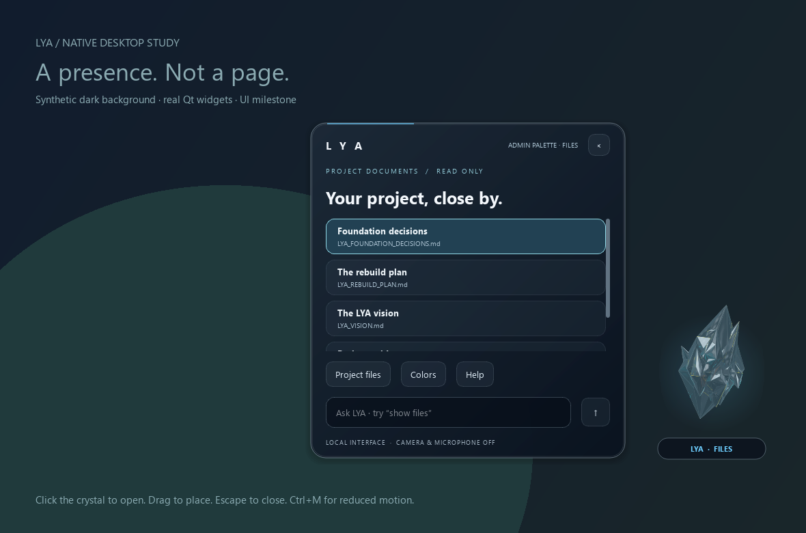
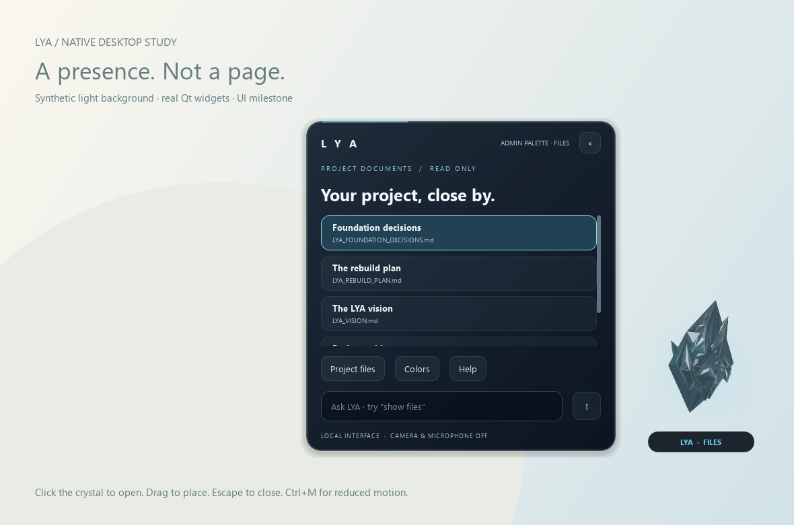

# Orb integration evidence — 2026-09-15

Decision: preserve the earlier orb as the default; offer the owner's model as an
experimental baked artwork option. No continuous real-time 3D renderer was added.

The supplied 6,878,188-byte GLB has 95,428 triangles and seven materials. Its copied
SHA-256 matches the original:
`e1bc93ea1ecd7ed48a64e9c70ea8ee327198ad0ba374f1dd2636aa0283c7c4ab`.
The one-time Qt/OpenGL bake uses installed libraries, approximate metallic/emissive
shading and alpha glass, without physical refraction. The final transparent
288 x 408 image passed the bake's nonempty-alpha guard and visual inspection.
The original artwork and user GLB are preserved.

## Checks

All 16 isolated native UI checks passed after the final default-selection change.
Coverage includes original default, artwork switching, bad-image fallback, finite
motion, hidden color changes and automatic slow-paint fallback with menu state.
The existing voice dispatch test was corrected to expect the recoverable orb when
an offscreen environment has no tray. These tests do not record voice or video.
No provider request, enrollment, private-memory change or deployment was performed.

## Short timing samples

Raw samples: [initial comparison](comparison.json) and
[alternating repeat comparison](repeated-comparison.json).
Each active workload lasts about 2.5 seconds. Repeat results:

| Artwork | Process CPU seconds | Median paint ms | Maximum paint ms |
| --- | ---: | ---: | ---: |
| Model, repeat 1 | 0.250 | 1.029 | 2.973 |
| Original, repeat 1 | 0.062 | 1.920 | 8.226 |
| Model, repeat 2 | 0.516 | 2.093 | 6.322 |
| Original, repeat 2 | 0.062 | 1.221 | 2.453 |

The initial model run used 1.250 CPU seconds versus 0.266 for the original.
Samples vary, but they do not establish equal CPU cost, so the original remains
the default. These are process-wide offscreen smoke measurements, not a controlled
battery benchmark, sustained performance test or physical-display FPS measurement.
All six runs stopped the idle drift timer and recorded zero additional paints in
the 1.2-second idle observation. Estimated unique pixmap storage was approximately
5.6MB for either selection; this is not whole-process memory usage.

## Synthetic previews

These show the optional model artwork, captured before restoring the original as
the default. Both were visually checked for layout, alpha edges and readability.
They are synthetic backgrounds, not screenshots of the user's desktop.

## Limits and next step

The optional artwork is a static rendered pose with existing task/person color
tints. It does not reproduce a full physical material renderer. The automatic
fallback observes painter latency only; it cannot detect all lag or battery draw.
Actual laptop battery testing would be needed before changing the default.
Next project milestone remains independent provider backup and answer verification,
followed by verified-identity/private-memory acceptance.
