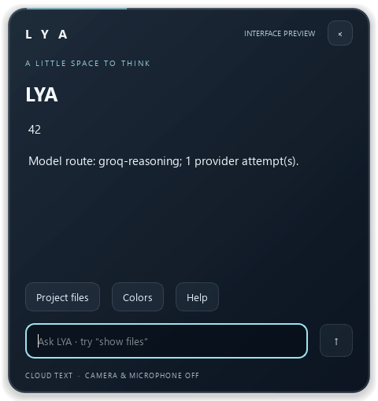

# Live provider evaluation and activation — 2026-09-14

## Result

The actual native Qt worker, Brain, SSH bridge, Oracle router and Groq returned
`42` for a synthetic arithmetic request. The selected route was groq-reasoning.
`desktop-live-check.json` records that integration check. The glass screenshot is
a visual replay of the captured answer, with explicit Segoe UI test-font loading
because Qt's offscreen backend initially rendered missing glyphs. No camera,
microphone, private-memory read or sensor capture was used.

Groq is enabled for public text only. A synthetic private-context request was
denied with no_eligible_route before a provider call. NVIDIA routes are disabled.
This establishes a working response path, not a dependable all-round assistant.

## What the live tests found

| Candidate | Observed result | Decision |
|---|---|---|
| Groq GPT-OSS 120B | Catalog and live generation work; eight cases completed after prompt tuning, but important quality defects remain | Experimental public-text primary; no tool execution or automatic fact saving |
| NVIDIA DeepSeek V4 Flash 0731 | In authenticated catalog; local timeouts at 8/25/30 s, Oracle timeout at 8 s | Disabled |
| NVIDIA GPT-OSS 20B | Correct arithmetic in about 1.9 s and corrected deadline in about 3.5 s; missing-fact question timed out at 8 and 25 s | Disabled; one success is not reliability evidence |
| NVIDIA Nemotron 3.5 Lightning | First evaluation call timed out at 8 s | Disabled |
| NVIDIA Mistral Large | Catalog listing did not match working generation; HTTP 404 | Not selected |
| Groq Qwen 3.8 27B | Four completed responses, then HTTP 429 | Not selected; no independent-provider backup |

Timing is a small sample, not a latency SLA or benchmark ranking. HTTP errors are
recorded without provider error bodies. No billing/free-tier guarantee is made.

## Preserved evaluation artifacts

- `groq-120b.json`: initial run stopped on output truncation during planning.
- `groq-120b-bounded.json`: eight completed responses with a stronger length prompt.
- `groq-120b-bounded-reviewed.json`: separate assistant review, 5/8 rubric passes;
  this is not a human signoff or a general accuracy score. The Tamil question was
  ambiguous about human versus software memory and needs a clearer follow-up.
- `groq-120b-evidence-policy.json`: subsequent run with stronger evidence/auth
  guidance. All requests completed; accuracy problems persisted. In particular,
  it proposes using an embedding model as a causal generator and supplies a wrong
  assertion for `AaBbA` (the first unique character is `a`, not `b`).
- `reviewed_character_function.py`: earlier reviewed pure-function sample; its
  isolated assertions passed.
- `reviewed_character_function_policy.py`: later reviewed pure-function sample;
  isolated assertions intentionally reproduce the model's incorrect test. This
  artifact is preserved evidence, not an accepted application test or code change.
- `nvidia-20b.json`, `nvidia-nemotron.json`, `groq-qwen38.json`: failed/partial
  comparisons. Missing cases were not scored as successes.

No generated infrastructure/security scripts were executed. The model's security
example initially trusted a client-controlled identity header; stronger guidance
produced a trusted-session outline, but its placeholder authentication/tests still
require implementation and verification. System prompts do not guarantee truth.

## Implementation checks and remaining gates

41 isolated tests passed across router, bridge, brain workflow and provider setup.
These use fake keys and temporary stores. The live integration evidence above is
separate. No full historical test-suite rerun or biometric validation is claimed.

The dotenv loader now accepts quoted values, inline comments and export prefixes
for known provider settings without executing or expanding contents. The two
NVIDIA note-style entries were normalized in place without exposing values.
The active Oracle config stores only the needed Groq credential, privately; the
entire .env was never uploaded. Desktop config contains no provider API key.

Restart the existing desktop to select the configured bridge, then ask a normal
text question. `brain status` reports the configured client; successful responses
show the actual route. For rollback, move aside ignored `desktop/oracle.local.json`
and restart; this returns to local model selection, which may itself be offline.

Next: establish an independent reliable provider using verified gateway details,
then add source retrieval and executable checks before trusting serious plans.
Private-cloud destinations, real identity binding, diverse council seats and
storage expansion remain deferred. Do not turn model guesses into permanent facts.
