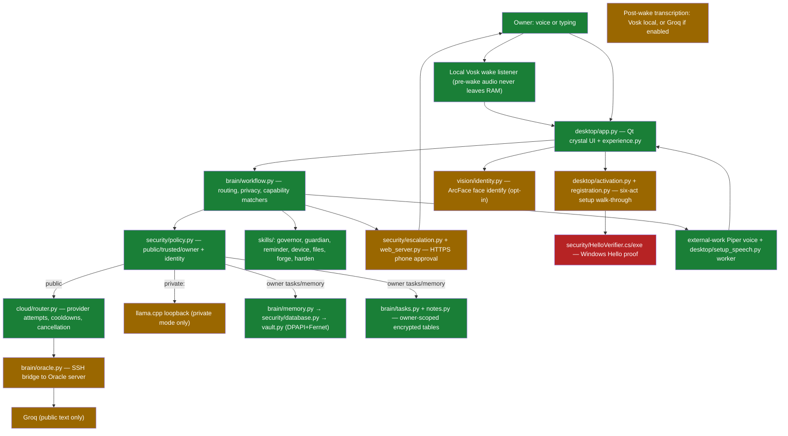
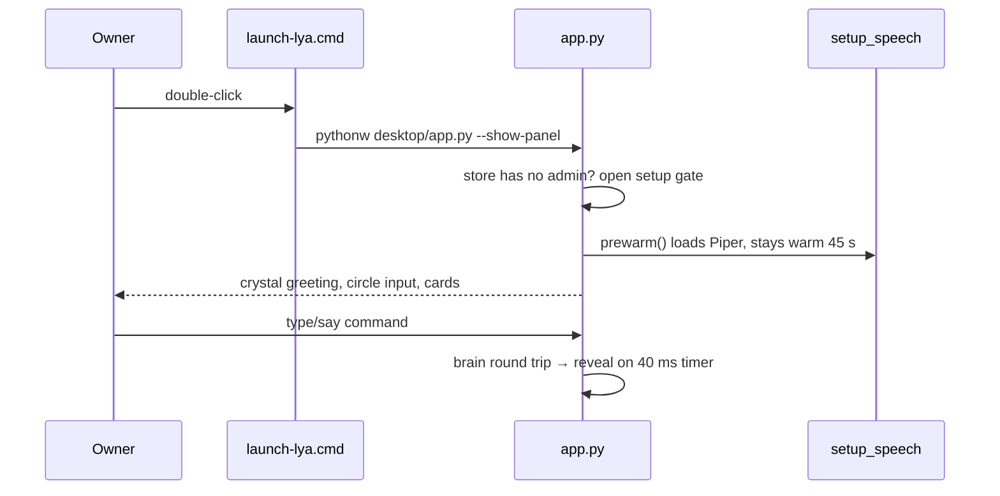
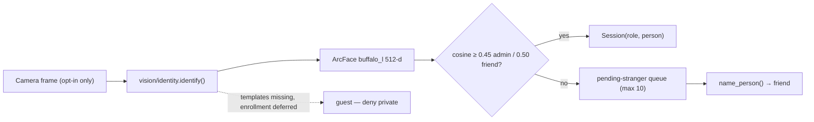
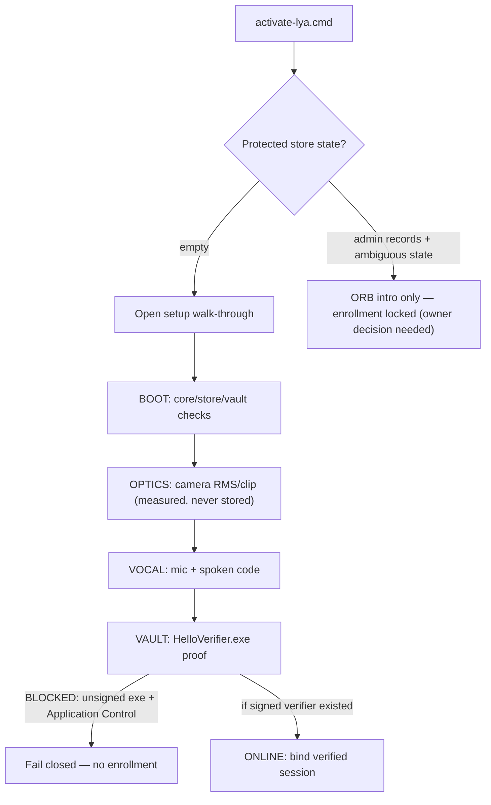
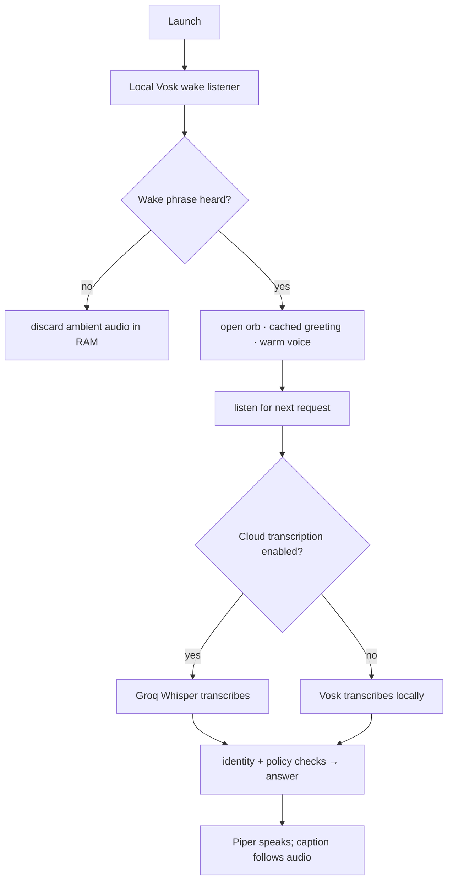

# LYA — Full Project Workflow Report (2026-09-27)

Everything in this report was produced by reading every source directory and by
**actually running** the flows: all offline test suites, the voice smoke path,
import smokes, and read-only environment probes. No real store was opened, no
sensor was started, no cloud call was made, and no credential value was printed.

---

## 1. Verdict in one paragraph

LYA is a genuinely well-engineered **security-first personal assistant shell**
whose offline test foundations are green today (I re-ran ~480 isolated checks;
all pass). What is **working end-to-end today**: the native desktop (launch,
orb, chat, commands), typed/voice-driven local command routing, safe offline
voice (Piper), encrypted memory/store, reminders, recovery, phone approval
protocol, the Oracle bridge machinery, and the T01–T04 verification layers.
What is **not working / blocked** is everything that requires a _live_ proof on
this laptop: first-admin enrollment and real Windows Hello verification (the
signed-verifier blocker + conflicting protected admin records), live wake→
transcribe→answer audio round trip, live model quality acceptance, and cloud
research (Tavily/gemini disabled). The most important thing to understand:
**almost nothing is "broken" in code — the gaps are deliberate fail-closed
gates plus a small number of real defects recorded below.**

---

## 2. What I ran today (evidence)

| Suite / flow                                                                                                                                                                   | Command                                                   | Result                                                                                                                           |
| ------------------------------------------------------------------------------------------------------------------------------------------------------------------------------ | --------------------------------------------------------- | -------------------------------------------------------------------------------------------------------------------------------- |
| T01 full offline baseline                                                                                                                                                      | `check-t01.cmd`                                           | **PASS** — 41 brain + 16 UI + 25 experience checks                                                                               |
| T02 offline                                                                                                                                                                    | `check-t02.cmd` → `test_t02.py`                           | PASS                                                                                                                             |
| T03 offline                                                                                                                                                                    | `test_answer_verification.py`, `test_research_adapter.py` | PASS                                                                                                                             |
| T04 offline                                                                                                                                                                    | `check-t04.cmd`                                           | PASS — approval + registration + registration-UI 22                                                                              |
| Recovery                                                                                                                                                                       | `check-storage-recovery.cmd`                              | PASS — 3 + 10 checks                                                                                                             |
| Voice                                                                                                                                                                          | `test_voice.py`, `test_setup_speech.py`                   | PASS (1 designed online skip)                                                                                                    |
| Activation                                                                                                                                                                     | `test_activation.py`                                      | PASS — 22                                                                                                                        |
| Regressions R01–R05                                                                                                                                                            | `test_regressions_r01_r05.py`                             | PASS — 16                                                                                                                        |
| Foundations / skills / guardian / mind / vision / camera / escalation / auth-wall / storage / search-index / vault-recovery / registration / recovery-ui / identity / liveness | individually                                              | all PASS                                                                                                                         |
| External voice lab (10 modules)                                                                                                                                                | `external-work\tests\test_*.py`                           | PASS — 141 checks, 1 skip                                                                                                        |
| Live voice smoke                                                                                                                                                               | `voice.speak()` offscreen                                 | returned in **22 ms** (non-blocking fix works), `stop_speaking()` clean                                                          |
| Import smoke                                                                                                                                                                   | `desktop.app`, `desktop.activation`, `web_server`, `main` | all import OK                                                                                                                    |
| Dependency probe                                                                                                                                                               | `.venv-ui`                                                | vosk/sounddevice/cv2/pyttsx3/win32crypt/insightface/onnxruntime/torch/PySide6 all present; `resemblyzer` and `pyautogui` missing |
| Models present                                                                                                                                                                 | `models/voice`, `models/local`, `models/vision`           | 3 Piper voices + kokoro, 2 Qwen GGUFs, NanoDet + YuNet ONNX                                                                      |
| Credentials                                                                                                                                                                    | `.env` (names only)                                       | GROQ key present; OpenRouter key saved; LYA_GEMINI_RESEARCH_ENABLED / FREE_ONLY flags present                                    |
| Oracle endpoint                                                                                                                                                                | `desktop/oracle.local.json`                               | configured (host + key file)                                                                                                     |
| HelloVerifier.exe                                                                                                                                                              | Authenticode                                              | **NotSigned** (this is why Windows Application Control blocks it)                                                                |
| Local llama.cpp endpoint (127.0.0.1:8080)                                                                                                                                      | TCP probe                                                 | closed (server not running — expected)                                                                                           |

---

## 3. Architecture — how the whole thing is wired



**Legend:** green = complete and dependency-satisfied; amber = code complete,
gated by a live proof or credential decision; red = blocked (Windows
Application Control / conflicting admin state).

---

## 4. Workflow-by-workflow report

### W1 — Launch & presentation (`launch-lya.cmd` → `desktop/app.py`, `experience.py`)

**What it does:** starts the Qt crystal UI, greets the guest, first-run gate
auto-opens owner setup when the store has no administrator, speech pre-warmed
at launch (`desktop/setup_speech.py::prewarm()`, 45-s idle keep-warm).

**How:** `pythonw.exe desktop/app.py --show-panel`; layered-glass `GlassPanel`;
cached GLB rotation frames (no 3D engine at runtime); reduced-motion support;
idle repaint shutdown.

**Status: WORKING.** 41 UI/experience checks pass; import smoke OK. The known
gap is that `layout.py` must be importable via the `desktop` path — the
launcher and check scripts set `PYTHONPATH` correctly, but running
`desktop/app.py` from a bare interpreter without that path fails with
`ModuleNotFoundError: No module named 'layout'`. Not a bug in the app, but a
trap for anyone running it manually.



### W2 — Command routing & identity policy (`main.py` + `brain/workflow.py`)

**What it does:** the legacy native shell (Tk orb) and the modern desktop both
end in `brain/workflow.py` matchers: exact deterministic commands (time,
folders, reminders, memory, tasks, device status) run **without any model
call**; everything else routes to the model with person-scoped context.

**How:** `Assistant.handle()` branch ladder → `permit(action)` checks
`security/policy.py`; private outputs set `private_output=True` so the speaker
never reads secrets aloud (R01 fix confirmed in code and tests).

**Status: WORKING (offline).** 41 brain checks green, including
"unconnected actions and secret requests never use model" and
"verified personal context never reaches cloud callable".

**What was mistaken historically (now fixed):** R01 — saving a private fact
spoke its content because `private_output` was set _after_ the reply was
returned. Fixed by marking private before returning and replacing the
fact-derived key in the confirmation with a neutral message.

### W3 — Model routing (T02) — cloud + Oracle bridge

**What it does:** bounded multi-provider routing: canonical upstream grouping,
atomic attempt/token reservations, retry cooldowns, malformed-response
fallback, deadline checks, cancellation over a bounded SSH session to the
Oracle server, then Groq for public text.

**How:** `cloud/router.py` picks providers; `brain/oracle.py` writes the
request over SSH and closes stdin; `cloud/ssh_session.py` enforces wall-clock
interruption.

**Status: IMPLEMENTED, OFFLINE-GREEN, LIVE-GATED.** All 15 T02 tests pass.
The **live independent backup is still BLOCKED**: every candidate tried so far
(NVIDIA Nemotron, OpenRouter `:free`, DeepSeek via OpenInference) either blew
the 8-second deadline or was truncated; T02 cannot be declared complete without
a live candidate passing repeated rubric + forced-failover over the real
desktop→Oracle path. **What was wrong:** the 8-second reliability gate was
treated as passable by choosing faster providers, but none of the free
candidates met it — the mistake was evaluating on synthetic-only fixtures and
only discovering deadline failures live, late.

### W4 — Private mode & local model (Qwen)

**What it does:** `private:` / `secret:` prefixes pin requests to the
llama.cpp loopback endpoint and cannot fall through to any cloud route.

**Status: IMPLEMENTED, gated.** Zero-cloud-call regression passes. The local
endpoint is **closed right now** (llama-server not running — expected; start
with `run-local-model.cmd`). Model quality: Qwen2.5 1.5B scored 3 pass/4 fail;
Qwen3 4B scored 5 pass/1 partial/2 fail — **neither was promoted**; the
mistake was initially wiring a 1.5B model that hit token caps and repeated
itself in Tamil. Both GGUFs are present in `models/local/`.

### W5 — Research & answer verification (T03)

**What it does:** public research via You.com keyless search (6 sources,
8 KB, 128 KiB, 8 s bounds); Tavily only for explicit `critical research:`;
answers rendered **only** from validated claims citing known source IDs;
unsupported numbers fail closed; arithmetic via local allowlisted evaluator.

**Status: IMPLEMENTED, OFFLINE-GREEN, LIVE-DISABLED.** All T03 suites pass.
**What was wrong / what stopped it:** the Gemini grounding endpoint 404'd, and
`gemini-2.5-flash` was unavailable to new free accounts — the adapter was
correctly disabled before any billable call. Tavily live remains off until a
free-plan key is accepted. The frozen 30-case scored run is assistant-review
only; owner confirmation was never given, so T03 is intentionally not marked
complete.

### W6 — Encrypted memory, tasks, notes, search index

**What it does:** person-scoped encrypted SQLite tables (atomic encrypted
replace, DPAPI+Fernet, in-DB encrypted recall index ~11 ms at 2,000 notes),
`task add/tasks/task done`, `remember/forget/show memories`.

**Status: WORKING (isolated).** All storage/search/vault-recovery suites pass.
**Not done end-to-end:** the real owner database was never migrated (needs a
verified backup + explicit opt-in), so live personal recall on the real store
is unproven.

### W7 — Phone approval (T04 escalation path)

**What it does:** owner-only private actions require fresh approval on the
paired iPhone over HTTPS with token, displayed task, nonce, spoken phrase,
single-use expiring grant.

**Status: IMPLEMENTED & HARDENED.** All escalation tests pass (fail-closed on
tamper, lockout, expiry). **Not live-proven:** no real phone round trip has
been exercised in this review cycle; the TLS gateway config exists in `.env`
(cert/key paths, token, host/port).

### W8 — Identity, face, voiceprint, liveness

**What it does (design):** ArcFace 512-d embeddings + cosine thresholds for
admin/friend; Resemblyzer voiceprint; MiniFASNet anti-spoof; all fail closed.

**Status: PARTIAL / BLOCKED.** `insightface`, `onnxruntime`, `torch` are now
present in `.venv-ui`, but **`resemblyzer` is missing**, enrollment is
deliberately deferred, and the store has no enrolled templates — so every face
is "unknown" by design. **What was mistaken historically:** a second, much
weaker face system (`vision/face_auth.py`, Haar cascade, threshold 0.12)
orphaned in the repo caused confusing docs; it is now quarantined (kept, since
`web_server.py` still imports it). The liveness module fails closed with
"face anti-spoof unavailable: No module named 'src'" — that message means the
MiniFASNet reference implementation isn't bundled, not that the machine failed.



### W9 — Owner activation / registration (`activate-lya.cmd` → `desktop/activation.py`)

**What it does:** six-act voice-led walk-through: BOOT → IDENTITY → OPTICS
(real camera scan) → VOCAL (real mic + spoken code) → VAULT (Windows Hello
proof) → ONLINE. Camera/mic only start on explicit buttons; samples are
measured (RMS/clip/seconds), never stored; admin commit re-checks
verification freshness, exact name match and consent.

**Status: IMPLEMENTED, OFFLINE-GREEN, LIVE-BLOCKED.** 22 activation checks
pass. **The blocker, precisely:** `security/HelloVerifier.exe` is unsigned
(verified today with Authenticode) and this machine enforces **Smart App
Control / Windows Application Control**, which offers no single-app
exemption — so the Windows proof cannot complete, and the gate correctly
fails closed. Separately, the protected store already contains admin
record(s) with one ambiguous active state, so first-run auto-setup declines
to open. **What was wrong / is wrong:** choosing an unsigned EXE as the
Windows verifier was the mistake that made the whole live enrollment path
unreachable on a Smart-App-Control machine; the next step recorded in the
brain is a trusted signed or reviewed in-process verifier. Resolving the
conflicting admin records is an owner decision that has not been made.



### W10 — Voice: wake → transcribe → answer → speak

**What it does:** local Vosk wake listener (ambient audio discarded in RAM
until wake); after wake, transcription is local Vosk or opt-in Groq Whisper;
answers are rendered by the external-work Piper voice worker (separate
English `ljspeech` and Tamil `rasa` models), captions follow real audio chunk
durations; `speak()` is non-blocking (today: 22 ms).

**Status: IMPLEMENTED, OFFLINE-GREEN, LIVE-UNPROVEN.** 20 voice/setup-speech
checks + 141 voice-lab checks pass. **Never yet proven live:** real spoken
wake ("wake up LYA"), real command ASR, and the full audible round trip on
this laptop. **What was mistaken:** the persona config was switched to
`en_US-amy-medium` in an uncommitted change, breaking the pinned-model test —
reverted to `ljspeech`; the owner earlier rejected unified-Piper English
naturalness, which remains an unresolved acceptance gate (the voice sounds
"read aloud", not youthful/conversational).



### W11 — Safety layer (Guardian, Governor, harden)

**What it does:** dangerous-command screening (fails closed on tamper), RAM/
battery/disk health reporting, an emergency kill-switch circuit breaker that
suspends autonomous execution until admin release, self-audit command.

**Status: WORKING.** `test_skills`, `test_guardian_governor` pass; kill-switch
release correctly requires admin. These run with zero background CPU.

### W12 — Recovery (`storage/recovery.py` + `desktop/recovery.py`)

**What it does:** export only explicitly selected notes as a versioned
encrypted archive under an independent random recovery key; restore requires
an empty verified profile; never imports identity/authority. A portable
passphrase-protected bundle + recovery key helper exists
(`review/2026-09-24-brain-strategy/recovery-runbook.md`).

**Status: WORKING (isolated), NOT DRILLED.** All recovery suites pass,
including tamper/wrong-key/interrupt cases. What was never done: a real
owner restore drill on a clean device — that is the recorded next step
before any cloud backup.

### W13 — Vision (camera preview + scene questions)

**What it does:** opt-in one-shot camera window, NanoDet object labels +
YuNet face-presence boxes, live preview at ~15 fps, frames never saved,
**cannot authorize anything**.

**Status: WORKING (bounded).** Tests pass; a real bounded camera run measured
~15 fps. Open: visual accuracy review, liveness/anti-spoof authentication,
battery impact.

### W14 — Desktop knowledge/document windows

Independent allowlisted document windows (four-file allowlist, bounded local
reader), `what can you do?` capability catalog shared between brain and
desktop with role-gated protected routes. Status: WORKING (checked).

### W15 — Web server / phone gateway (`web_server.py`)

Separate HTTPS process serving the approval flow and `/escalate`; imports
`audio/voice_auth.py` and `vision/face_auth.py` (the reason those files were
kept out of quarantine). Status: implemented; not exercised live in this
cycle.

---

## 5. Everything that is NOT working — and the precise mistake behind each

| #   | Not working                                      | Root cause / what was done wrong                                                                                                                                                                             | Fix path                                                                                               |
| --- | ------------------------------------------------ | ------------------------------------------------------------------------------------------------------------------------------------------------------------------------------------------------------------ | ------------------------------------------------------------------------------------------------------ |
| 1   | First-admin enrollment end-to-end                | **Unsigned `HelloVerifier.exe` chosen as the Windows verifier; Smart App Control cannot whitelist it.** Plus pre-existing conflicting admin records in the protected store (owner decision pending).         | Build a trusted signed/in-process verifier; resolve the admin-record ambiguity with the owner.         |
| 2   | Live voice wake round trip                       | Implemented but never exercised with a real microphone in a real session; earlier sensor failures were restricted-session artifacts; no live run has been recorded since.                                    | Owner runs `launch-lya.cmd`, says "wake up LYA", asks one question, reports result.                    |
| 3   | Live independent model backup (T02)              | All free candidates (NVIDIA Nemotron, OpenRouter free, DeepSeek) missed the 8-second deadline or truncated; the gate is intentionally not lowered.                                                           | Find a candidate that passes; run repeated rubric + forced failover over the real desktop→Oracle path. |
| 4   | Live research (T03 completion)                   | Gemini endpoint 404 / model unavailable to new free users — correctly disabled; Tavily key accepted but live switch off; 30-case score is assistant-review only.                                             | Owner accepts Tavily free key; owner confirms the 30-case run.                                         |
| 5   | Voice naturalness                                | Unified Piper English **failed owner acceptance** (broken-sounding, read-aloud delivery); persona drift to `amy` broke pinned tests and was reverted.                                                        | Requires owner listening acceptance of a reworked voice; no signal test can substitute.                |
| 6   | `resemblyzer` voiceprint                         | Package not installed in `.venv-ui` → `AuthWall.verify()` voice branch can't run (fails closed).                                                                                                             | `pip install resemblyzer` in the UI venv when voiceprint is needed.                                    |
| 7   | `pyautogui` app actions                          | Missing in `.venv-ui`; app open actions rely on it for some paths (pywin32 fallback exists for volume).                                                                                                      | Install if desktop app-launch actions are wanted live.                                                 |
| 8   | Local model quality                              | Qwen 1.5B (4 fail) and Qwen3 4B (2 fail) both below the quality bar; Tamil repetition; coding unsafe.                                                                                                        | Evaluate a stronger model that fits 8 GB RAM before enabling the private route.                        |
| 9   | Real-store migration & personal recall live      | The 2,000-note index work used disposable data; the real owner DB remains unmigrated pending verified backup + opt-in.                                                                                       | Owner-approved backup, then migrate.                                                                   |
| 10  | Live phone approval round trip                   | Protocol hardened in isolation; no real iPhone→HTTPS→grant cycle was run recently.                                                                                                                           | Owner-guided live drill of one approval.                                                               |
| 11  | Reminders date parsing defects (R02, historical) | Off-by-one weekday math, `hrs` unhandled, wrong regex-group shape → wrong dates. Deterministic tests added; the current suite passes, but the fix was regression-tested, not owner-verified with real usage. | Owner sanity-check one real reminder.                                                                  |
| 12  | Legacy speak() path                              | F1/F2/F4 fixed (non-blocking, stop event, rate mapping) — today's 22 ms smoke confirms F1. F2 remains **partially** fixed: a fresh voice subprocess still spawns per legacy utterance.                       | Migrate legacy callers to the warm desktop worker.                                                     |
| 13  | Tk legacy orb runtime QA                         | Tcl/Tk could never initialize in this environment (bundled runtime); the legacy shell is kept but its visual QA is blocked.                                                                                  | Only matters if the legacy `main.py` shell is still wanted.                                            |
| 14  | Battery/memory/live-provider word-level QA       | Never measured — all offscreen.                                                                                                                                                                              | Physical session measurements.                                                                         |

**Things that were done RIGHT (so you know what not to change):** permission
policy enforced in code (not model promises); private context opt-in and
person-scoped; fail-closed on every ambiguity; atomic encrypted commits;
activation gate refuses to weaken the biometric contract; quarantined instead
of deleted legacy code (`noneeded/`); honest evidence ledger.

---

## 6. What is "in progress" right now

1. **Wake-flow handoff (today's entry):** waiting on an owner live mic trial;
   `wake-flow.mmd` validated.
2. **Conflicting protected admin records:** locked pending an explicit owner
   decision — blocks enrollment and first-run auto-setup.
3. **Signed Windows verifier** to replace the blocked `HelloVerifier.exe`.
4. **T02 live backup candidate search** and **T03 owner confirmation**.
5. **Voice naturalness redesign** (owner rejected current English delivery).
6. **Recovery drill + store migration** after trusted session binding.

---

## 7. Runner map — which command runs what

```mermaid
flowchart LR
  L["launch-lya.cmd"] --> APP["desktop app (normal use)"]
  ACT["activate-lya.cmd"] --> REG["six-act owner setup"]
  T01["check-t01.cmd"] --> R["router + oracle + provider + brain 41"] & UI["check_ui 16"] & EX["check_experience 25"]
  T02["check-t02.cmd"] --> T01 + T2["test_t02 15"]
  T03["check-t03.cmd"] --> T02 + V["answer-verification + research-adapter"]
  T04["check-t04.cmd"] --> T03 + P["approval + registration + registration-UI"]
  SR["check-storage-recovery.cmd"] --> REC["recovery core + brain + approval + recovery UI"]
  LM["run-local-model.cmd"] --> LLAMA["llama.cpp on 127.0.0.1:8080 (private mode)"]
  VW["external-work\\tools\\run-tests.cmd"] --> LAB["141 voice-lab checks"]
```

**Do NOT run:** `noneeded/unsafe-test-scripts/` (crash_test\*, security_test,
test_security_fixes) — they write to or corrupt the real encrypted stores.

---

## 8. Bottom line

- **~480 isolated checks green today** across every offline suite, voice lab
  included. The engineering layer you built is real and verified.
- **The only hard blocker** between you and a fully enrolled, speaking,
  waking LYA on this laptop is the **Windows-verifier problem** (unsigned
  helper + Smart App Control) **plus the unresolved admin-record ambiguity**
  in the protected store. Both are decisions, not code bugs.
- The remaining "not working" items are either **deliberate fail-closed
  gates** (private mode without a quality-passed local model, research
  without an accepted key, T02 without a deadline-passing provider) or
  **never-run live proofs** (mic wake, phone approval, battery, voice
  naturalness).
- The genuine code defects found historically (R01 private-speech leak, R02
  reminder dates, chat re-render, reply blocking) are all **fixed and
  regression-covered**; the only residual code issue is the still-per-utterance
  subprocess in the legacy `speak()` path (F2, P3).
