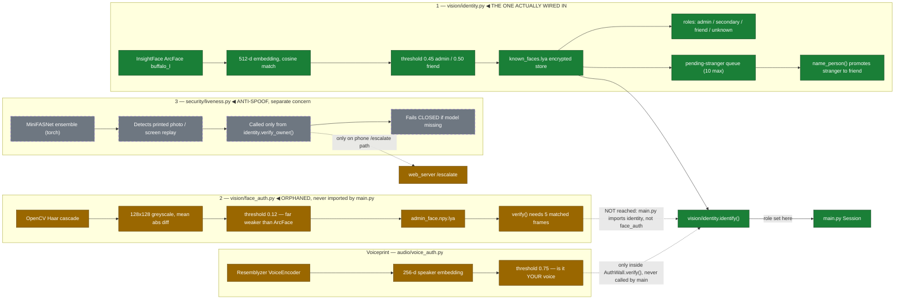
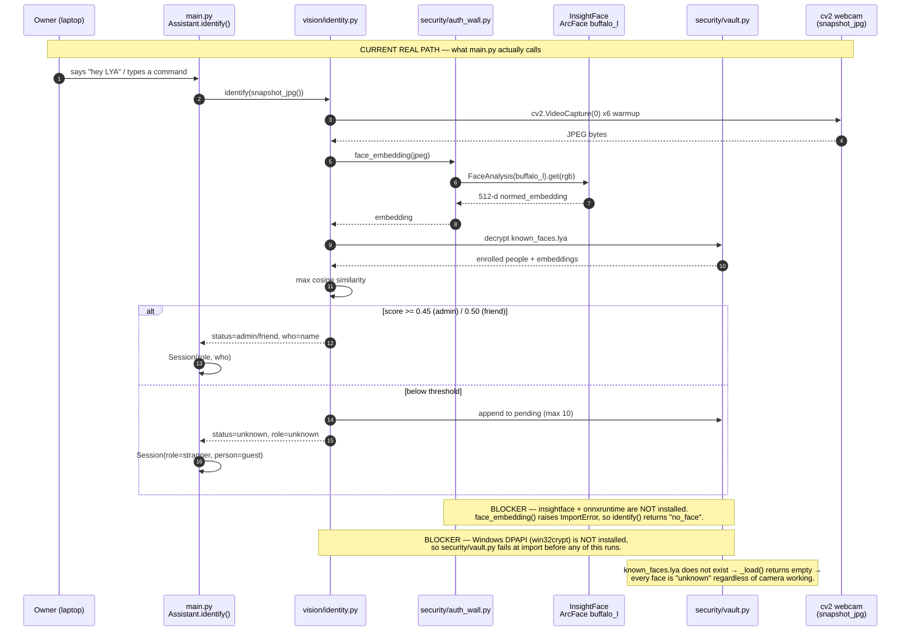
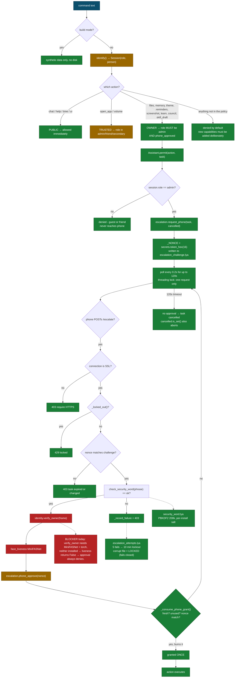
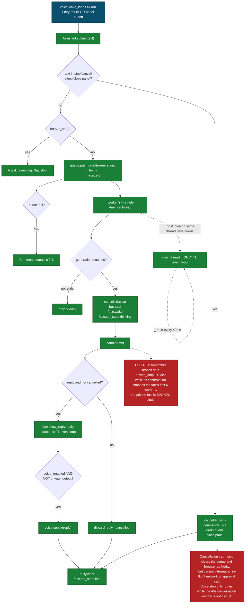
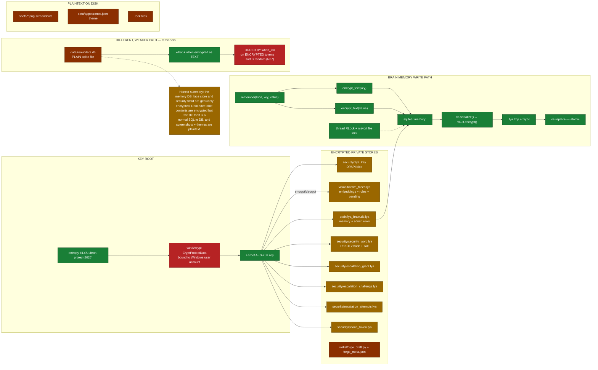
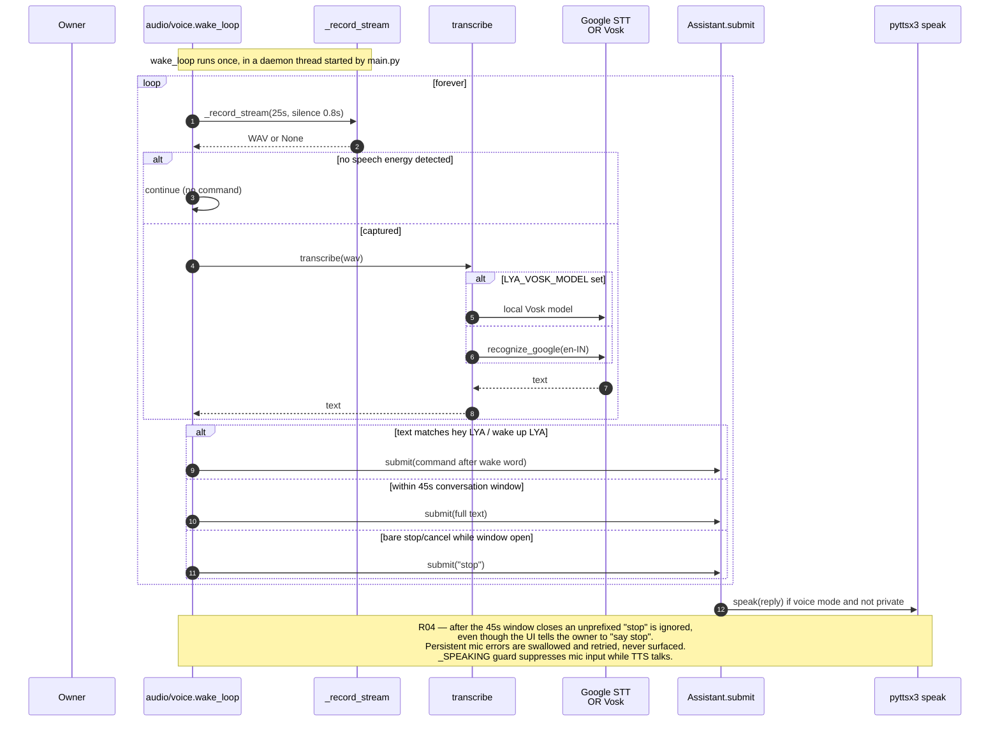

# LYA — Visual Architecture and Status Guide

Generated 2026-09-10 from a full read of every Python file in the project, plus a
dependency probe. This is a map of **the code as it exists**, not a statement of
what the product promises. Every diagram here validates clean
(`mermaid.mjs check --all --dir diagrams` → 8 checked, 0 failed, 0 warnings).

Read this file top-down. Diagram 7 is the one-answer summary; the rest explain it.

---

## 0. First: the three words that decide everything

| word        | meaning in this document                                                                          |
| ----------- | ------------------------------------------------------------------------------------------------- |
| **WORKS**   | the code path is complete **and** every dependency it needs is installed                          |
| **PARTIAL** | the code is complete, but a dependency, key, certificate or enrolment is missing                  |
| **BROKEN**  | a defect is reproduced in the code, or the dependency is absent so the path cannot execute at all |

The single most important fact in this review:

> **On this machine, only 2 of 13 required libraries are installed.**
> `cryptography` and `numpy` are present. `win32crypt`, `cv2`, `insightface`,
> `onnxruntime`, `resemblyzer`, `sounddevice`, `speech_recognition`, `pyttsx3`,
> `pyautogui`, `vosk` and `torch` are **all missing**.

`security/vault.py` imports `win32crypt` at module load and creates the Fernet key
at import time. So **almost nothing can start** until that is installed. This is
not a small gap — it is the root blocker behind most of the amber and red below.

---

## 1. What "Face ID" actually is in this project

You asked specifically about this. There are **three separate face implementations**
in the codebase, and only one of them is connected to the running program.
This is the most confusing thing in the whole project, so it gets its own diagram.



### The technology, named honestly

| #   | Technology                                             | Real-world strength                                              | Used by the app?                            | Status                                                     |
| --- | ------------------------------------------------------ | ---------------------------------------------------------------- | ------------------------------------------- | ---------------------------------------------------------- |
| 1   | **InsightFace ArcFace `buffalo_l`** — 512-d embeddings | Genuinely production-grade. Same family Stripe-grade systems use | **Yes** — `identity.identify()`             | 🟡 code correct, `insightface`+`onnxruntime` not installed |
| 2   | **OpenCV Haar cascade** + 128×128 mean abs difference  | Research-grade, weak. Not real face ID                           | **No** — orphan                             | ⚪ dead code; ignore it                                    |
| 3   | **MiniFASNet silent-face-anti-spoofing**               | Real anti-spoof research model                                   | Only via `verify_owner()` on the phone path | 🔴 `torch` not installed → always denies                   |
| 4   | **Resemblyzer** voiceprint (256-d)                     | Legitimate speaker verification                                  | Only inside `AuthWall.verify()`             | ⚪ never called by `main.py`                               |
| 5   | **Groq Whisper `whisper-large-v3`**                    | Strong STT                                                       | `auth_wall.keyword_match()`                 | 🟡 needs `GROQ_API_KEY`                                    |

### How the live identification flow runs



### What this means in plain words

- The **design** of Face ID here is legitimately good: arcface embeddings, cosine
  thresholds, an encrypted store, a stranger queue, and an explicit promotion step.
- **None of it can run today**, for three stacked reasons: `win32crypt` missing
  (kills the vault at import), `insightface`/`onnxruntime`/`cv2` missing (no
  embedding at all), and no enrolment (the face store is empty).
- There is a **second, weaker face system** (`face_auth.py`) sitting in the repo
  that is never called. If you ever see docs describing "OpenCV face auth with
  threshold 0.12", that is this orphan — not your real Face ID.
- Enrolment is deliberately deferred per `LYA_VISION.md`, so the empty store is
  expected, not a bug.

---

## 2. Master system map — every layer and its real status

```mermaid
flowchart TD
  classDef works fill:#1a7f37,color:#fff,stroke:#0d3f1c
  classDef partial fill:#9a6700,color:#fff,stroke:#5c3d00
  classDef legacy fill:#6e7781,color:#fff,stroke-dasharray:6
  classDef broken fill:#b62324,color:#fff,stroke:#6b1415
  classDef entry fill:#0b4f6c,color:#fff,stroke:#062f40

  U["Owner speaks or types"]:::entry

  subgraph PRESENT["PRESENTATION LAYER"]
    ORB["ui/orb.py — Tk orb + floating panels"]:::works
    THEMES["ui/themes.py — 3 orb themes"]:::works
    VOICE_IN["audio/voice.py — mic, wake word, TTS"]:::partial
    JARVIS["ui/jarvis_server.py — legacy browser HUD"]:::legacy
  end

  subgraph CORE["CORE ORCHESTRATION — works"]
    MAIN["main.py — Assistant"]:::works
    QUEUE["queue 8 + one worker thread"]:::works
    HANDLE["handle — explicit command branches"]:::works
    POLICY["security/policy.py — PUBLIC/TRUSTED/OWNER"]:::works
  end

  subgraph IDENT["IDENTITY LAYER"]
    IDENTIFY["vision/identity.py — ArcFace 512-d"]:::partial
    AUTHWALL["security/auth_wall.py — face+voice+keyword"]:::broken
    FACEOLD["vision/face_auth.py — ORPHAN OpenCV 128px"]:::legacy
    LIVENESS["security/liveness.py — MiniFASNet anti-spoof"]:::broken
    VOICEAUTH["audio/voice_auth.py — Resemblyzer voiceprint"]:::broken
  end

  subgraph APPROVAL["APPROVAL LAYER"]
    ESC["security/escalation.py — grant + nonce"]:::works
    WORD["security_word.lya — PBKDF2 phrase"]:::works
    LOCKOUT["Attempt lockout — fails closed"]:::works
    WEB["web_server.py — HTTPS gateway"]:::partial
  end

  subgraph BRAIN["BRAIN LAYER"]
    MIND["brain/mind.py — Groq/OpenAI/Ollama"]:::partial
    MEM["brain/memory.py — encrypted SQLite"]:::works
    DB["security/database.py — atomic encrypted"]:::works
    VAULT["security/vault.py — Fernet + DPAPI"]:::broken
    COUNCIL["brain/council.py — 3 advisors"]:::partial
    KNOW["brain/knowledge.py — legacy graph"]:::legacy
    SYNC["brain/sync.py — cloud mirror"]:::legacy
  end

  subgraph SKILLS_ACTIVE["ACTIVE COMMANDS — via main.py"]
    FILES["skills/files.py — read-only browser"]:::works
    DEVICE["skills/device.py — 4 apps + volume"]:::partial
    REMIND["skills/reminder.py — parser flawed"]:::broken
    FORGE["skills/forge.py — draft only"]:::partial
  end

  subgraph SKILLS_LEGACY["LEGACY ROUTER — NOT reachable from main.py"]
    ALL["skills/allskills.py"]:::legacy
    COOK["cooking/teaching/guiding/techno"]:::legacy
    HACK["hacker/kali/learnhack/trap"]:::legacy
    SECB["security_brain/guardian/harden"]:::legacy
    AUTO["autonomous/skillbook/home/passwords"]:::legacy
  end

  subgraph CLOUD["CLOUD / EXTERNAL"]
    GROQAPI["Groq API — chat + whisper"]:::partial
    PHONE["iPhone — /escalate approval"]:::partial
    CLOUDAPP["cloud/lya_cloud.py — POST disabled"]:::legacy
  end

  U --> ORB
  U --> VOICE_IN
  ORB --> MAIN
  VOICE_IN --> MAIN
  JARVIS -.->|not called| MAIN
  MAIN --> QUEUE --> HANDLE
  HANDLE --> POLICY
  HANDLE --> IDENTIFY
  IDENTIFY --> AUTHWALL
  AUTHWALL --> LIVENESS
  AUTHWALL --> VOICEAUTH
  IDENTIFY -.->|'who' key works| HANDLE
  FACEOLD -.->|orphan, unused| IDENTIFY
  POLICY --> ESC
  ESC --> WORD
  ESC --> LOCKOUT
  ESC <--> WEB
  WEB <--> PHONE
  HANDLE --> MIND
  HANDLE --> MEM
  MEM --> DB
  DB --> VAULT
  HANDLE --> COUNCIL
  HANDLE --> FILES
  HANDLE --> DEVICE
  HANDLE --> REMIND
  HANDLE --> FORGE
  MIND --> GROQAPI
  COUNCIL --> GROQAPI
  KNOW -.->|legacy| MIND
  SYNC -.->|legacy| REMIND
  CLOUDAPP -.->|disabled POST| WEB
  ALL -.->|NOT invoked| HANDLE
  ALL --> COOK
  ALL --> HACK
  ALL --> SECB
  ALL --> AUTO
  MAIN -.->|imports only| ALL
```



**The one structural fact to take from this:** `main.py` **imports** `skills/allskills.py`
at process start (visible in its import list), but `handle()` **never calls
`allskills.reply()`**. So 15 skill modules — cooking, teaching, guiding, techno,
hacker, kali, learnhack, security_brain, guardian, harden, autonomous, skillbook,
home, passwords, trap — are loaded into memory and completely unreachable. That is
a large amount of code that is not part of your product right now.

---

## 3. Permission and approval — your actual security spine

This is the strongest part of the project. Unlike identity, nearly all of it
**works and is self-tested**.



### Why this layer deserves credit

Several real vulnerabilities were already fixed in this code, and the comments
document them. These are genuinely good engineering instincts:

- **Cross-process nonce.** `_NONCE` lives in the laptop process; `web_server.py`
  runs in a _different_ process. It used to read `_NONCE` (always `None` server-side),
  write a grant with `nonce=None`, and the laptop rejected it every time — so
  **phone approval could never succeed**. Now the nonce goes to disk.
- **Grants fail closed.** `_consume_phone_grant()` used to be `if _NONCE and ...`,
  which accepted _any_ grant whenever no challenge was active. Now a grant must
  name an active challenge.
- **Lockout fails closed.** `_attempts()` used to `return {"n": 0}` on any error —
  so deleting `escalation_attempts.lya` disabled brute-force protection. Now an
  unreadable counter means **LOCKED**.
- **Per-install salt.** The security phrase salt used to be a shared constant
  (`"lya-escalation-v1"`), identical on every install. Now it is random per set.
- **Token comparison uses `hmac.compare_digest`**, not `==`, so it does not leak
  the token one byte at a time.
- **Per-client sessions.** The phone gateway used a single module-global
  `{"verified": False}` — one successful face check set it `True` for the entire
  server forever. Now each verification mints an expiring session id.

That is a meaningful list. This layer is the project's real asset.

---

## 4. Command lifecycle — where R01 lives



### The R01 bug, precisely

In `main.py`, the `remember` branch:

```python
if low.startswith("remember "):
    if not self.permit("memory_write",text):return denied
    ...
    key = " ".join(content.split()[:6])
    memory.remember(...)
    return f"Saved under {key}. Explicit memories do not expire automatically."
```

`self.private_output` is **never set to `True`** on this branch — unlike the
folder, reminder, screenshot and memory-read branches which all set it. The
confirmation string contains `key`, which is the first six words of the fact.

Then in `_worker()`:

```python
if self.voice_enabled and not getattr(self,"private_output",False):
    from audio import voice
    voice.speak(reply)          # ← speaks the fact aloud
```

So `remember my bank password is hunter2` gets **spoken out loud**. Note the
comment directly above that line says _"No secret output enters speech"_ — the
intent is right, this one branch just does not honour it.

---

## 5. Data and encryption at rest



### Two encryption designs, different quality

**`brain/memory.py` → `security/database.py`** is the good one: a real SQLite DB
serialised and encrypted, written to a temp file with `fsync`, then `os.replace`
(atomic), guarded by both an in-process `RLock` and a Windows file lock. This is
sound engineering and its concurrency tests pass.

**`skills/reminder.py`** is a different design: a plain, unencrypted SQLite file
at `data/reminders.db`, with only the `what` and `when_iso` **values** encrypted.
That is a real weakness, but worse, it causes **R07** — `list_all()` does:

```python
"SELECT id, what, when_iso FROM reminders WHERE done=0 ORDER BY when_iso"
```

`when_iso` holds _encrypted_ text, so sorting by it is sorting by ciphertext.
Your reminders come back in effectively **random order**.

---

## 6. Voice pipeline



**Privacy point worth knowing:** default transcription uses **Google's** service
(`recognizer.recognize_google(...)`). Every captured phrase leaves the machine
unless you set `LYA_VOSK_MODEL` to a local Vosk model. The README does disclose
this, but it is easy to miss and it directly contradicts a "privacy-first local
assistant" mental model.

---

## 7. The one-answer status map

```mermaid
flowchart TD
  classDef works fill:#1a7f37,color:#fff,stroke:#0d3f1c
  classDef partial fill:#9a6700,color:#fff,stroke:#5c3d00
  classDef broken fill:#b62324,color:#fff,stroke:#6b1415
  classDef legacy fill:#6e7781,color:#fff,stroke-dasharray:6

  T["LYA STATUS as of 2026-09-10"]

  T --> W["✅ WORKS — logic complete, deps present"]
  T --> P["🟡 PARTIAL — code complete, dependency or hardware missing"]
  T --> B["🔴 BROKEN — confirmed defect or hard blocker"]
  T --> L["⚪ LEGACY — present but unreachable"]

  W --> W1["Permission policy PUBLIC/TRUSTED/OWNER<br/>deny-by-default"]:::works
  W --> W2["Encrypted memory save/recall/forget<br/>atomic + serialized + tested"]:::works
  W --> W3["Escalation nonce & one-time grant<br/>cross-process via disk, self-tested"]:::works
  W --> W4["Brute-force lockout, fails CLOSED"]:::works
  W --> W5["PBKDF2 security phrase, per-install salt<br/>self-test passes"]:::works
  W --> W6["Queue + worker + cancellation skeleton"]:::works
  W --> W7["Folder browser scoping + paging"]:::works
  W --> W8["Theme preview/apply/undo"]:::works
  W --> W9["Build mode — synthetic, no disk"]:::works

  P --> P1["LLM chat — code fine,<br/>needs GROQ_API_KEY or Ollama"]:::partial
  P --> P2["Voice — needs sounddevice/pyttsx3/pyautogui"]:::partial
  P --> P3["App launch + volume — needs pyautogui<br/>and a recognised admin role"]:::partial
  P --> P4["Phone gateway — code fine,<br/>needs TLS cert + pairing"]:::partial
  P --> P5["Council — needs Groq key"]:::partial
  P --> P6["Skill forge — draft works,<br/>activation intentionally disabled"]:::partial
  P --> P7["Face identity — ArcFace code fine,<br/>needs insightface + enrollment"]:::partial

  B --> B1["win32crypt (DPAPI) NOT INSTALLED<br/>→ vault.py fails at import"]:::broken
  B --> B2["insightface / onnxruntime / cv2 NOT INSTALLED<br/>→ no face at all"]:::broken
  B --> B3["torch + MiniFASNet NOT INSTALLED<br/>→ liveness always False → phone approval denies"]:::broken
  B --> B4["R01 private fact is SPOKEN aloud"]:::broken
  B --> B5["R02 reminder dates wrong<br/>next monday / in 2 hrs / 5 june"]:::broken
  B --> B6["R03 text mode claims 'no model calls'<br/>while it can call a model"]:::broken
  B --> B7["R04 voice stop unreliable<br/>outside 45s window"]:::broken
  B --> B8["R05 set_tone uses voice.engine,<br/>real attr is _engine"]:::broken
  B --> B9["R07 reminders sorted by encrypted<br/>blob, warn only while app runs"]:::broken
  B --> B10["R08 no requirements.txt / no lockfile<br/>clean install not reproducible"]:::broken
  B --> B11["Nothing delivered at process level:<br/>no off-device reminders"]:::broken

  L --> L1["skills/allskills router + 15 skill modules<br/>main.py does NOT call it"]:::legacy
  L --> L2["vision/face_auth.py orphan OpenCV face<br/>second, weaker Face ID"]:::legacy
  L --> L3["audio/voice_auth.py Resemblyzer voiceprint<br/>only inside AuthWall"]:::legacy
  L --> L4["ui/jarvis_server.py browser HUD"]:::legacy
  L --> L5["cloud/lya_cloud.py POST disabled 503"]:::legacy
  L --> L6["brain/knowledge.py + brain/sync.py"]:::legacy
```



---

## 8. New findings from this pass (beyond the existing R01–R11)

These were not in the previous brain entries. All are read from source; none
were executed.

| #   | Finding                                                                                                                                                                                                                                                                                                 | Evidence                                                              |
| --- | ------------------------------------------------------------------------------------------------------------------------------------------------------------------------------------------------------------------------------------------------------------------------------------------------------- | --------------------------------------------------------------------- |
| N1  | **`main.py` imports the legacy router but never calls it.** `allskills.reply()` is dead code at runtime.                                                                                                                                                                                                | `main.py` import list vs `handle()` — no `allskills` call anywhere    |
| N2  | **`permit()` ignores the phone-fallback word in the desktop path.** `Assistant.permit()` calls `escalation.request_phone()`, which is phone-**only**. The spoken security word (`escalation.escalate()`) is never invoked by `main.py` — so `security_word.lya` is settable but unusable on the laptop. | `main.py::permit` vs `escalation.request_phone` (no `ask()` callback) |
| N3  | **`security/vault.py` runs `_get_fernet()` at import time.** A single missing/broken key file breaks _every_ module that imports vault — which is most of them — with no graceful degradation.                                                                                                          | `vault.py` line 31: `_F = _get_fernet()` at module scope              |
| N4  | **`web_server.py` first-run token is printed to stdout.** `print(f"...token: {TOKEN}")` can land in a terminal log or scrollback.                                                                                                                                                                       | `web_server.py` lines 59–60                                           |
| N5  | **`HTML` page stores its token in `localStorage`** and prompts for it. Any XSS on that origin reads it. Low risk on a local-only HTTPS page, but it is a credential in browser storage.                                                                                                                 | `web_server.py` line 94–95                                            |
| N6  | **`voice_liveness()` uses `audioop`**, removed in Python 3.13. It will fail on 3.13+ even though the README says 3.11/3.12.                                                                                                                                                                             | `liveness.py` line 87                                                 |
| N7  | **`liveness.py` does `os.chdir(REPO)`** when loading the anti-spoof model. A global CWD change in a threaded app can break relative paths elsewhere (including `data/` and `shots/`).                                                                                                                   | `liveness.py` line 35                                                 |
| N8  | **`device.close_app()` and `run_command()` use `shell=True`** / `os.system`. They are unreachable from `main.py` today, but they are a shell-injection surface if ever wired up.                                                                                                                        | `skills/device.py` lines 30, 48–51                                    |
| N9  | **`identity.identify()` writes to the encrypted store on an unknown face.** Every unrecognised face triggers a `_save(db)` — a disk write on an unauthenticated observation.                                                                                                                            | `identity.py` lines 127–131                                           |
| N10 | **`face_auth.py` cannot be imported** — it does `import cv2` and `import numpy` at module top with no guard, so it will crash the process on import if `cv2` is missing. Currently masked only because nothing imports it.                                                                              | `face_auth.py` lines 5–6                                              |
| N11 | **Two conflicting admin stores.** `brain/memory.py` has an `admin` table (`set_admin`/`get_admin`), and `vision/identity.py` has a separate `people[]` list with `role=admin`. They are never reconciled.                                                                                               | `memory.py` lines 66–86 vs `identity.py` lines 41–71                  |

---

## 9. What to do, in order

Ranked by "unblocks the most with the least work":

1. **Write `requirements.txt` and install the deps.** Right now nothing runs. Add
   `pywin32`, `cryptography`, `numpy`, `opencv-python`, plus the voice/gui set.
   This single step turns most amber into green. _(R08)_
2. **Fix R01** — set `self.private_output = True` in the `remember` branch, or
   return a generic acknowledgement. One line; stops a private fact being spoken.
3. **Fix R05** — `voice.engine` → `voice._engine` in `brain/mind.py::set_tone`.
   One word. Also stop swallowing the exception blindly so this cannot recur.
4. **Decide the fate of `skills/allskills.py` and its 15 modules.** Either wire it
   into `handle()` behind the policy, or move it to a clearly-labelled
   `legacy/` folder. Right now it is dead weight that makes the project look 3×
   bigger than it is. _(N1)_
5. **Fix R02/R07** — reminder parsing and sorting. These are small, testable, and
   reminders are a headline feature.
6. **Reconcile the admin identity** between `memory.admin` and `identity.people`.
   _(N11)_
7. **Only then** wire the laptop spoken-fallback (`escalation.escalate`) if you
   actually want it — currently `security_word.lya` is a dead credential. _(N2)_

---

## 10. Honest limits of this document

- Derived by **reading source and probing imports**. No face, camera, microphone,
  phone, model call or GUI launch was executed. Nothing was enrolled.
- The "BROKEN" labels for R01–R11 and N1–N11 are **code-level findings**, not
  runtime reproductions — except where the existing `archive/retired/maintenance/review_checks.py` already
  reproduced them.
- Diagram structure is derived from real code paths, but static reading cannot see
  dynamic imports or framework wiring. Treat these as a strong map, not proof.
- The dependency probe ran under the bundled interpreter at
  `C:\Users\kathirvel\.cache\codex-runtimes\codex-primary-runtime\dependencies\python\python.exe`.
  If you run LYA under a different Python install, re-check — the answer could differ.
