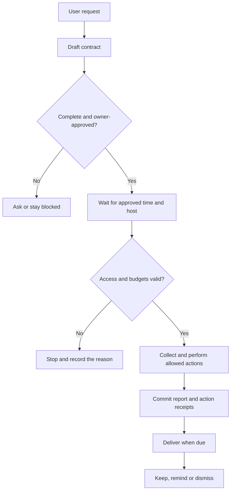

# LYA automation strategy and execution contract

Source implementation: 2026-10-16. This is the governing design and an executable
foundation, not a claim that WhatsApp, YouTube, phone push or an Oracle scheduler
is connected. Existing accepted desktop/news behavior is unchanged. The current
executor supports daily technology-update and inbox-review contracts; it is not a
general program executor or universal natural-language automation system.

## The rule for every future automation

A request becomes a **draft contract** first. Resolve missing accounts, time zone,
importance criteria, input scope, permitted actions and output destination. Bind
verified owner approval to the exact contract revision and expiry. Only then may a
qualified adapter run it on an allowed host, within its budgets. Incoming messages,
webpages and model output are data; they cannot create authority, add recipients,
raise budgets, change schedules, approve jobs or choose executable programs.

| Decision | Required contract |
| --- | --- |
| What and why | A supported task kind and the intended result; unknown task kinds are refused |
| When | Explicit daily start and report times, IANA time zone and missed-run grace |
| Input scope | Named account/source, bounded lookback and cutoff; no implicit whole-account history |
| Where | Desktop or Oracle; placement is checked at execution |
| Private data | Separate explicit remote-processing permission, current account rights and protected report storage |
| How far | Time, request, item, result-byte and reply-attempt caps |
| What may change | Draft-only by default; exact approved catalogue for narrowly delegated replies |
| What matters | Owner-defined importance-rule references validated by the connector; uncertainty remains separate |
| When to stop | Finish, deadline/cap, cancellation, revocation, missing access or uncertain external outcome |
| What to return | Durable result reference, completion/partial/failure state, counts and receipt states |
| When to notify | A separate report-time outbox, relevance filter and owner-bound notification route |
| How long to keep it | Explicit report expiry; bounded metadata/audit stores and maintenance policy |
| What happens next | Authenticated keep, explicit-time reminder or dismissal; no implicit website operation |

The compiler/front end must present the complete contract in plain language before
enabling it. A natural-language `approved: true`, a model's confidence, or an old
phone session is not ongoing delegated account access. This source provides the
structured contract API; a speech/chat contract compiler and owner-review UI are
still pending. Authority callbacks must be wired to fresh verified owner proof,
protected identity checks and exact-operation approval before production use.

## The owner's 6 PM / 7 PM example

Proposed behavior in **Asia/Kolkata**:

1. At **18:00**, attempt a short inbox-review job on the approved host. Read only
   the connected account and the approved lookback/window. A default example allows
   60 seconds, eight provider requests, 100 items and 32 KiB of result output.
2. Classify under explicitly selected owner rules. Keep important, routine and
   uncertain findings distinct. Classification accuracy is adapter-dependent, not
   established by this executor. `important_only` deliberately suppresses uncertain
   items; `important_or_uncertain` can send them with an uncertainty label. Select
   the intended tradeoff rather than silently guessing what “main message” means.
3. If an incoming item requests an approved resource, either leave it for review
   under draft-only mode, or apply an explicitly delegated catalogue rule. Use the
   verified inbound target and exact approved link. Never invent a URL, broadcast
   to all followers, or assume WhatsApp senders are verified YouTube subscribers.
4. Commit a bounded report reference and action receipt states, then **stop**.
   The job does not keep an AI model working for the hour until 19:00.
5. At **19:00**, a separate invocation can request the owner notification if the
   chosen filter matches and authorization/report retention are still valid.
   An incomplete collection can queue a clearly partial report instead of claiming
   there was nothing important. A missing connector produces a blocked run.

The collection window ends at the scheduled time. A message arriving at **18:30**
is not covered by an 18:00 snapshot. If coverage closer to 19:00 is required, propose
a second bounded check, such as 18:55, with its own reviewed timing/cost scope.
Account adapters must enforce source timestamps, pagination/checkpoints and this
cutoff. Those real adapters are not installed here.

The words “daily at six” also need an explicit AM/PM and time zone when not already
established. “Notify later” needs a real reminder time. “Send links” needs a resource
catalogue, recipient/channel scope, permitted provider window and a reply cap. The
job must remain a draft or blocked when these are missing. The sample contracts
in `docs/examples/automation-contracts.json` are proposals, not approvals.

## Scheduling, placement and stopping

The daily calculator handles Asia/Kolkata and IANA zones. It skips nonexistent DST
wall times; repeated times select the first occurrence once. A bounded grace period
allows only the latest due slot; it does not backfill weeks of missed work. Outside
the due window, no run is started. A supervising service must surface missed runs
and schedule notifications; that host service is still pending. Operating-system
clock changes, time-zone database availability and downtime require host qualification.

A durable unique slot prevents normal duplicate execution after restart or concurrent
claims. An approved revision changes the contract digest and may deliberately admit
a new revision's latest due slot. A running or unresolved run blocks another run of
that job. Recovery disables/fences the old delegation and leaves an explicit review
state; it does not silently replay unknown actions. There is no automatic takeover,
distributed scheduler, hard exactly-once provider guarantee or arbitrary retry loop.

Current hard admission ceilings are 120 cooperative seconds, 20 provider-request
reservations, 200 items, 64 KiB result output and 20 outgoing reply attempts per run.
The owner can choose lower caps. Delegations expire within thirty days. At each
trusted-adapter boundary, cancellation, deadline and the current exact delegation
are rechecked. Revocation/recovery increments a generation, fencing later work and
report completion. A trusted receipt can still be recorded for an external request
that already completed while authority was changing.

**These are cooperative adapter limits, not an OS sandbox.** The engine cannot
preempt a hanging/malicious Python callback, inspect hidden connector calls, enforce
provider billing, or attest which physical machine called itself Oracle. Production
adapters must use bounded transports, verified account capabilities, input budgets,
zero-spend eligibility and protected report stores; a supervised isolated worker
with hard process/network/resource limits remains required for production cutover.
Public research and message bodies must never be executed as code or shell commands.

Laptop-off work needs an online server and a deployed timer/worker. The existing
Oracle instance is a candidate, not evidence of capacity, uptime or production
qualification. This task installs no cloud service, OS timer, startup hook or paid
resource. A phone/desktop client retrieves result references; it must not repeat
server collection merely because another device opened the inbox.

## Outgoing links and notification receipts

The executor accepts only registered trusted adapters. No WhatsApp or YouTube
adapter exists in this change. A connector must establish current account access,
approved scopes, recipient identity, source authenticity and provider messaging
requirements. A recipient comes from a verified inbound-item reference, never from
instructions embedded in its text. A per-message callback must attest that the
request, target and resource belong together before a reply is attempted.

For delegated catalogue replies, persist intent **before** calling the provider.
The identity is account plus inbound item, shared across jobs/revisions. A confirmed
matching receipt suppresses duplicate replies. A different payload for the same
item, timeout, crash or missing acknowledgement leaves uncertainty and requires
reconciliation. Never blindly resend. The callback must retain actual provider
receipts in an appropriate protected store and return an opaque reference; this
engine cannot independently authenticate an invented connector receipt.

Notifications are a distinct owner-only route. They require a trusted zero-spend
notifier and one request attempt with a ten-second transport-timeout parameter.
The contract, current delegation, report expiry and due time are checked. An uncertain
push request remains `requesting`; it is not retried automatically. A provider
request acknowledgement is not proof the OS displayed it or the owner read it.
Push subscriptions, permissions, qualified transport and cross-device UI are pending.

Keep/later/dismiss decisions require verified owner authority for the matching job
contract. A later reminder must have an explicit time within seven days and before
report expiry. Keep records a bookmark; it does not extend private-report retention.
Dismiss hides the result/notification; it does not delete a WhatsApp message,
YouTube comment or external provider record. External website actions need their
own registered capability and exact scope; opening a link does not authorize
signups, posts, software installation or purchases.

## Data boundaries and implementation

`cloud/job_policy.py` validates/hash-binds the contract and computes daily slots.
`cloud/job_store.py` stores protected control metadata, approval generations, run
states, immutable contract snapshots, actual start/finish times, budget counters,
action fingerprints/receipt references and outbox decisions. No message or
report body enters that control database; exception details are reduced to fixed
reason codes so provider errors cannot leak messages into it. Job/account/owner
references must be non-credential identifiers. The store is a trusted local control
plane, not an authenticated remote API or tamper-resistant custody system.

`cloud/job_runner.py` performs bounded execution through trusted callbacks. It
refuses absent connectors, missing private storage, unestablished zero-spend status,
changed authority and unsupported placement. A completed run means its collection,
permitted actions and report reference completed; notification is reported separately.
Partial, blocked, cancelled, limit-reached, needs-review and failed are distinct.

`cloud/job_adapters.py` supplies only an optional public technology-feed adapter
and public-only report sink. The existing hourly desktop watcher has not been moved
to this daily-policy engine. Public reports have expiry/read/purge checks; the
private sink and messaging/notifier integrations are deliberately absent. A fake
RAM sink is used only in the lab. Private reports may be retained at most 24 hours
under this initial schema; public reports up to seven days. Logical SQLite limits
and row caps stop growth, but are not disk-wide quotas or secure erasure. Audit/action
rows are not silently deleted to regain quota; retention/reconciliation maintenance
must be designed before capacity is reached.

## Qualification and next sequence

1. **This delivery:** structured strategy, bounded engine, durable metadata, public
   adapter, synthetic 18:00/19:00 example and failure-focused regression evidence.
2. **Next:** review the contract/compiler UI and wire real owner/delegation checks.
   Qualify host placement, process limits, protected reports and durable custody.
3. Choose and connect the actual provider/accounts. Confirm whether requests arrive
   in WhatsApp, YouTube comments or both, and define important-message rules and
   exact link mappings. Obtain only the required account scopes.
4. Stage one public-only scheduled job on the existing server, with observable
   failures, bounded resource measurements, delivery receipts and rollback.
5. Qualify one private read-only digest before enabling any delegated sending.
   Then qualify single-recipient catalogue replies, ambiguous outcomes/reconciliation
   and the shared inbox/phone notification path. No production cutover is implied.

The [dated report](../../review/2026-10-16-job-strategy/README.md) links tests and the
reproducible no-network lab. An execution framework is not evidence that a provider
connection, semantic classifier or autonomous assistant is working.

Primary integration references checked 2026-10-16:

- [Meta-maintained WhatsApp Cloud API collection](https://www.postman.com/meta/whatsapp-business-platform/documentation/wlk6lh4/whatsapp-cloud-api): describes business-account/number prerequisites; this is not proof of access to an ordinary personal inbox. Direct Meta pages were unavailable/rate-limited in this research session, so live requirements must be rechecked.
- [YouTube comments implementation](https://developers.google.com/youtube/data/guides/implementation/comments): distinct retrieval/reply APIs and OAuth-authorized mutations. The user's channel and scopes are not connected here.
- [Python IANA timezone support](https://docs.python.org/3/library/zoneinfo.html): requires system zone data or first-party tzdata; no silent UTC fallback.
