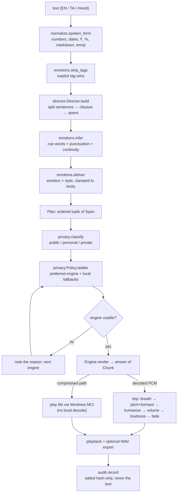
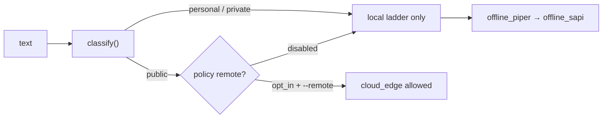

# 02 — Architecture

How one sentence becomes audio, and where every decision is made.

## The pipeline



## Layers and responsibilities

| Layer | Module | Responsibility | Must not |
|---|---|---|---|
| Identity | `persona.py` | One speaker: name, age, F0, languages, styles, voice map | Hold per-language "different people" |
| Emotion | `emotions.py` | 22 emotions, aliases, tag parsing, cue inference, `deliver()` | Change what is said |
| Text | `normalize.py` | Written → spoken form | Invent or drop words |
| Direction | `director.py` | Text → `Plan` of `Span`s (per-clause prosody) | Produce empty plans for real text |
| Finishing | `dsp.py` | Pitch shift, formant preservation, vibrato, breath, loudness | Cost a GPU or a neural model |
| Policy | `privacy.py` | Classify sensitivity, decide engines fail-closed | Mask-and-send a secret |
| Glue | `runtime.py` | Resolve ladder, render, play, cancel, report | Silently substitute a refused engine |
| Engines | `engines/*` | Produce `Chunk`s; report availability cheaply | Open audio devices in `available()` |

## The two data types that carry the design

**`Span`** (`director.py`) — one clause of speech with everything an engine needs:

```
text, source, language, emotion,
rate_pct, pitch_hz, volume_pct,      # delivery deltas vs her neutral voice
pause_after_ms, breath_before,       # timing
contour, humanize_cents, breath_amount, index
```

**`Chunk`** (`engines/base.py`) — one rendered span. It carries **either** decoded
`numpy` PCM **or** a compressed file `path`. The runtime is explicit about which
path it took, which is why the DSP stage applies to local engines and is skipped
for the remote MP3 stream instead of pretending otherwise.

## Emotion has to come from us

Neither Piper nor Edge can act "cheerful" on request:

- **Edge** exposes only `rate` / `volume` / `pitch` and **cannot** apply
  `mstts:express-as` styles (see `docs/01-research.md`).
- **Piper** has no style conditioning at all — only pacing.

So emotion is produced **by this stack**: the director shapes per-clause prosody,
and the DSP stage applies the audible character (pitch contour, micro-vibrato,
breaths, cadence). That is also what keeps one timbre sounding like a living
speaker rather than a synthesiser.

## Fail-closed routing



Two rules that matter:

1. **Masking is not a licence to send.** Anything above `public` is routed local or
   refused — it is never redacted and then transmitted, because redaction changes
   what she says.
2. **An explicit engine is a contract.** If the caller names `cloud_edge` for text
   the policy refuses, `speak()` raises rather than quietly speaking it in another
   voice.

## One voice across two languages

`config/persona.json` maps engines to voices:

- `cloud_edge` — `en-US-AvaMultilingualNeural` for **both** languages (one timbre).
- `piper` — `unified` uses the Tamil-trained model for both languages (identical
  timbre, English accent suffers); `native` uses one model per language (better
  each, two timbres).

The `--timbre unified|native` flag chooses. `unified` is the default because the
brief asks for *one girl*, not "a different girl per language".
