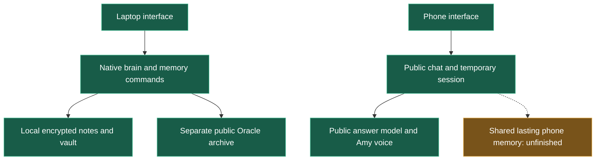
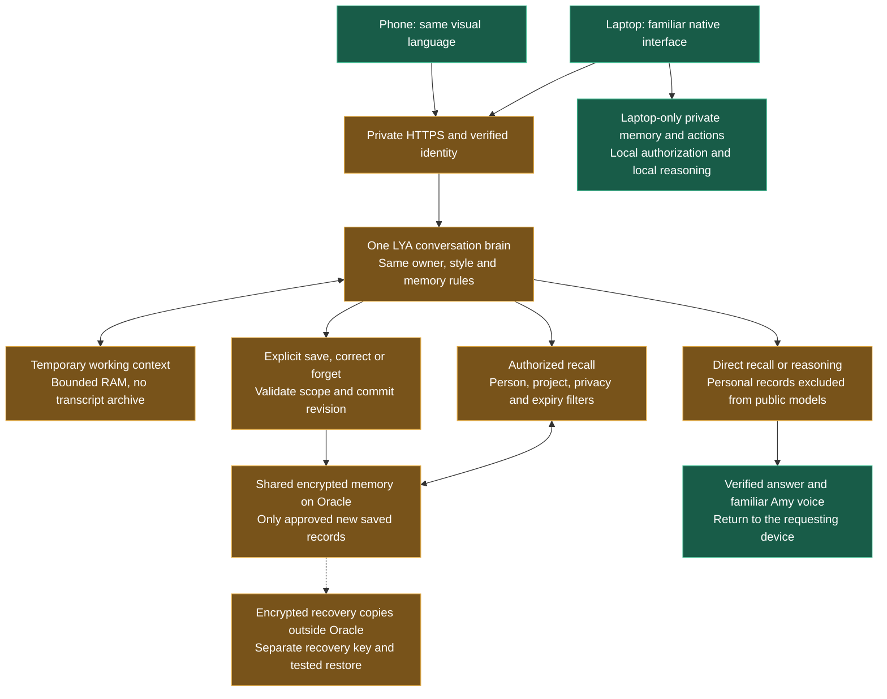
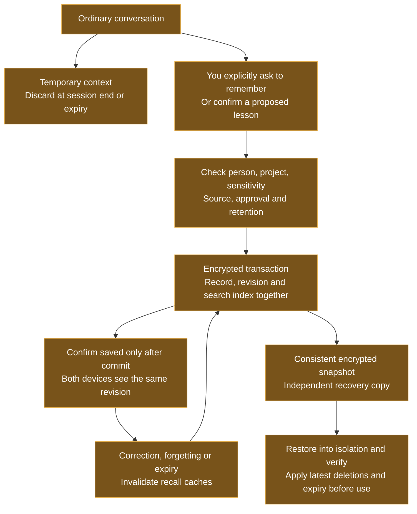

# LYA brain and storage: understandable design

Design review, 2026-10-11. This document explains the recommended destination,
not a completed integration. No runtime, retention, deployment or private-data
placement changed for this document. Server-readable personal memory still needs
the owner's placement decision before implementation.

**Recommendation:** one logical LYA with one authoritative store for approved
shared memories, temporary conversation context, a separate laptop private vault,
and encrypted recovery copies outside the live server. The model produces answers;
the memory system preserves selected knowledge. Model weights are not retrained
on every conversation.

## 1. What exists today

Green means existing components, not complete end-to-end acceptance. The laptop
has explicit memory commands and protected storage. Its current note store is
capped at 2,000 notes per person and rewrites the encrypted database file on each
write. Phone chat keeps only the last two exchanges in session RAM. The existing
public Oracle archive is a separate public-only store, not private phone memory.
Neither interface has the complete eight-layer experience originally discussed.

Source: `brain/workflow.py`, `brain/notes.py`, `storage/store.py`,
`storage/public_archive.py`, `cloud/mobile.py`, `cloud/mobile_runtime.py`.
The import-trace tool misses dynamic wiring; the diagram also uses direct source
inspection. No real profile/store was read to establish these statements.

## 2. The proposed shared system

Amber means proposed integration; green means retained components. Phone visuals
were adapted to the laptop style earlier today; real phone visual acceptance is
still pending. One identity means one logical owner namespace, not one shared
login token. Each device retains its own session and cancellation state. Owner
tone follows verified identity and approved preferences; calling oneself admin
does not grant authority. Native Windows actions remain laptop-only.

The shared service would hold NEW explicitly saved records approved for that
placement. It can serve those records while the laptop sleeps, provided the
server and network are available. Existing private laptop notes, vault, photos,
credentials and biometrics remain local. Private laptop recall is unavailable
from the phone while the laptop is off. No silent copying into the public archive.

The Oracle service must decrypt shared records to search/use them. Encryption at
rest does not hide them from an authorized server process or a compromised server.
This is the central trust decision, still pending owner approval. Ordinary public
models receive public context only. Simple personal recall can be answered
directly; open-ended private reasoning needs an approved private/local model path,
or must report that capability unavailable. It must never fall back to exporting
private context to the public model.

## 3. What each brain layer means

These are responsibilities, not eight new databases or eight AI models.

| Layer from our neural schema | Its job | Storage and lifetime |
|---|---|---|
| L0 Senses | Receive speech/text and approved input | Audio buffers in RAM; discard after processing. No recording archive by default. |
| L1 Working memory | Understand the current turn and short conversation | Bounded session RAM; disappears on expiry/restart. |
| L2 Episodic memory | Selected events worth preserving | Ordinary chat remains temporary; an explicitly pinned summary becomes a scoped record. |
| L3 Semantic memory | Facts, preferences, decisions and people/project relationships | Encrypted selected records with source, approval and expiry. |
| L4 Procedural memory | How to perform an approved task | Versioned skill/code files, reviewed and tested before activation. A conversation cannot install a skill. |
| L5 Self model | Approved interaction style, abilities and limits | Versioned configuration and selected owner preferences; no invented personal history. |
| L6 Verification | Check identity, evidence, permissions and outcomes | Rules plus minimal safe operation metadata; no transcript or secret logging. |
| L7 Consolidation | Deduplicate, propose lessons, expire temporary records and maintain backups | Bounded maintenance work; proposals need confirmation. No automatic collection or scheduling enabled here. |

People remain separate. A fact about another person belongs to an authorized
owner/project context; it does not create a shared global profile or grant that
person access. Model guesses stay unconfirmed and cannot overwrite owner facts.

## 4. What is stored, where, and for how long

| Information | Recommended home | Retention rule |
|---|---|---|
| Ordinary dialogue and temporary plans | RAM | Session only; no default full transcript storage. |
| Explicitly remembered facts/preferences/decisions | Approved shared encrypted store, or explicitly local-only store | Existing choices: 7 days, 90 days, exact expiry, or permanent. Preserve the requested choice; clarify ambiguity rather than silently choosing forever. |
| Confirmed lessons | Scoped memory record, with supporting evidence | Explicit retention and review; unconfirmed suggestions are not durable knowledge. |
| Public research | Separate public archive, with source and checked date | Refresh when needed; old claims do not become timeless facts. |
| Approved large attachments | Separate encrypted files, with a database reference | Separate opt-in, quota and retention; do not copy existing private files. |
| Passwords, provider keys and biometrics | Dedicated protected credentials/vault facilities | Never ordinary notes, public prompts or plaintext logs. |
| Recovery copies | Encrypted independent destination and offline copy | Bounded backup policy; old backups may retain deleted content until they expire. |

Permanent means no automatic age-based deletion, not an immortality guarantee.
If a quota is reached, stop the new save and explain it; do not silently delete
permanent memories. Lower recall ranking is different from deletion.

Each saved record needs an ID, owner/person scope, project, kind, sensitivity,
value, source/evidence, approval state, created/updated times, revision and expiry.
Corrections replace the active revision. Forgetting creates a minimal deletion
marker without the forgotten value, so an older backup cannot silently resurrect
it. Any retained revision history must obey the same retention/privacy policy.

## 5. The life of one memory

Example: “Remember my preferred reply style permanently” creates one approved
preference, not a saved copy of the whole conversation. A phone correction changes
that same record; the laptop sees the new revision. A network failure must produce
a clear save failure/pending status, never a false “saved.” The initial design has
one authoritative shared database, not two competing writable device replicas.

## 6. What technology would be used

| Component | Choice and purpose | Status |
|---|---|---|
| Interfaces | Existing PySide6 laptop and HTML/CSS phone, familiar Amy voice | Existing; shared behavior still needs integration. |
| Private transport and sign-in | Existing Tailscale/private HTTPS and passkey infrastructure, with narrowly scoped memory grants and common owner mapping | Foundations exist; shared-memory authorization is new work. |
| Brain orchestration | Reuse Python rules/workflow; one shared memory/personality contract and per-device adapters | Proposed integration; preserve accepted voice and interaction. |
| Shared memory database | Recommend SQLCipher, an encrypted SQLite build, with indexed scoped rows and FTS5 search inside the encrypted database | New recommendation only; driver/build, FTS5, encrypted temporary-file settings, memory use and recovery must be qualified first. |
| Existing laptop vault | Existing Fernet encryption and Windows DPAPI key protection | Preserve; no automatic conversion or upload. |
| Public archive | Existing separate SQLite/FTS public archive | Existing, public-only. |
| Attachments | Encrypted files plus scoped database references | Optional future opt-in, not a new collection feature. |
| Recovery | Consistent encrypted snapshot, attachment manifest, schema version and independently protected key recovery | Proposed; current isolated backup checks do not prove full cross-device disaster recovery. |

SQLCipher encrypts database pages individually, so the proposed shared store need
not rewrite its entire encrypted file on every small edit. Its encrypted journal
pages do not remove the need to disable plaintext temporary stores and audit logs.
This is a design rationale, not a measured speed result. [SQLCipher design](https://www.zetetic.net/sqlcipher/design/)

SQLite is appropriate behind a small server API when writes can be serialized.
Devices use that API; they do not share a database file over a network filesystem.
If measured write contention later warrants a server database, plan a tested
migration then. [SQLite deployment guidance](https://www.sqlite.org/whentouse.html)

FTS5 supplies indexed text lookup. Typed relationships and selected context help
recall, but keyword search does not guarantee understanding every paraphrase.
Embeddings/vector search are optional later improvements only if an evaluation
shows a real recall gap; they are not needed to remember a named preference.
[SQLite FTS5](https://www.sqlite.org/fts5.html)

## 7. Staying fast and recoverable for years

**Fast:** filter by authorization before ranking or building prompts; index
person/project/type/expiry and searchable text; retrieve a few relevant records;
keep conversation/context and caches bounded. Cache entries must include scope,
revision and expiry and be invalidated on correction/forgetting. Never send all
years of history into every model request. Run backup/maintenance outside the
reply path. Voice latency must be measured separately at pause detection,
transcription, lookup, inference and first audio; fast storage alone cannot remove
the current sequential voice delay. No latency target has been demonstrated here.

**Durable:** use transactions with a deliberately tested durability setting,
space checks, bounded journals, explicit save acknowledgements and a backup before
schema upgrades. A consistent snapshot/export must be tested with the selected
encrypted driver, not produced by blindly copying a live database file.
[SQLite backup guidance](https://www.sqlite.org/backup.html)

**Recoverable:** proposed copies are (1) live Oracle memory, (2) an encrypted
recovery copy outside Oracle, such as the laptop, and (3) an encrypted offline
copy, such as an external drive. A second folder on the same VM is not independent
recovery. An encrypted file without its recoverable key is useless. Recovery must
include database, approved attachments, format/schema version and a separately
protected key package; Windows-bound key protection alone is not portable recovery.

Suggested policy for review, not a configured schedule: daily backup when changed,
seven daily plus four weekly generations, monthly offline copy, restore exercise
every three months and before major migrations. Backup loss exposure is the time
since the last verified independent copy; daily backup can lose up to a day's
changes. Offline backups can retain forgotten values until rotated. Restore must
load the newest independent deletion register and enforce current expiry before
serving results. If that register is missing, require reconciliation before use.

An Always Free Oracle VM may be reclaimed when Oracle's idle criteria are met.
Keeping years of knowledge requires independent recovery rather than relying on
the VM alone. [Oracle Always Free policy](https://docs.oracle.com/en-us/iaas/Content/FreeTier/freetier_topic-Always_Free_Resources.htm)

**Security:** least-privilege service/key permissions, authenticated encrypted
transport, fresh authorization for sensitive operations, encrypted searchable
indexes/backups, redacted logs and no personal context in public models. Audio
already sent for public speech recognition cannot be made private retroactively;
private input needs a suitable private/text path selected before capture. No
encryption claim covers an unlocked compromised endpoint or server.

## 8. What must be proved before calling this complete

With fake secrets and temporary stores first: laptop save -> phone recall while
laptop sleeps; phone correction -> laptop new revision; separate-person/project
isolation; expired/forgotten records absent from recall and stale caches; public
provider payloads exclude personal records; crash/capacity failures never produce
false save acknowledgements; isolated backup restore preserves current deletions
and expiry. Then measure the chosen database and reply stages under realistic
bounded data/concurrency. Real owner acceptance follows authorized deployment.

Today this is a design artifact, with structurally validated Mermaid diagrams.
No new database installed, real memory collected, keys moved, backup scheduled or
service deployed. The existing server limits and SQLCipher compatibility have not
been qualified for this design. No system can promise permanent availability or
zero loss; the design makes the trust, capacity and recovery limits explicit.

Evidence: source review and official documentation. The Agent Reach public-web
route was attempted but unavailable (local command absent / Jina DNS failure);
official pages were read through the available web tool. No private inputs sent.

Standalone diagrams: [today](01-today.mmd), [shared system](02-shared-brain.mmd),
[memory lifecycle](03-memory-life.mmd). Validation: `diagram-validation.json`.
