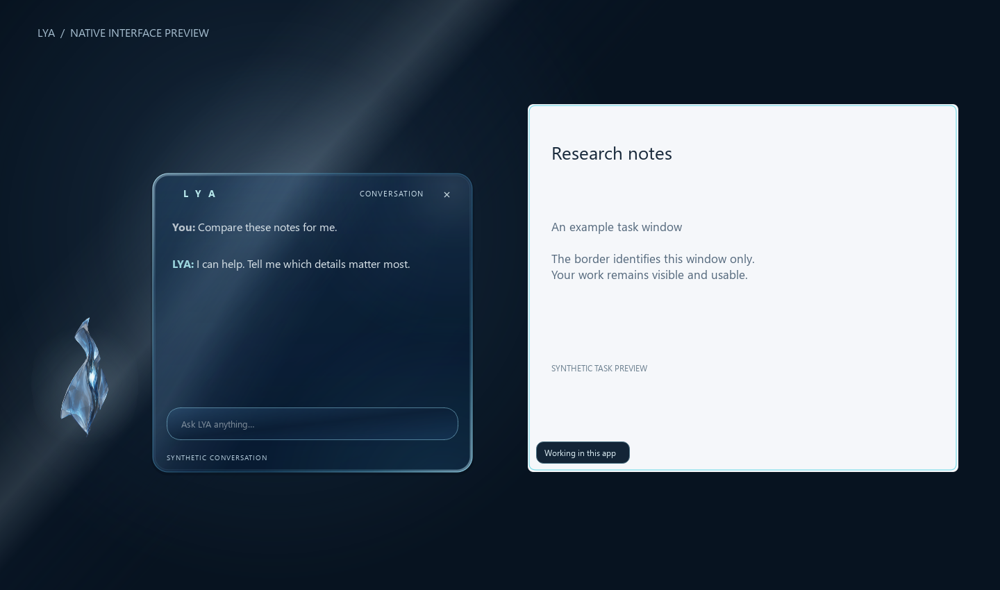

# Native glass conversation and task border

Implemented against main `945eeec364fa743ef56c1ec5276f06d4f581cd44` after the owner approved the conversation/app-border visual and required low battery impact.

## Runtime

- `desktop/glass_style.py`: rounded navy surface, fixed reflective gradients and a restrained hairline. No screenshot capture, live backdrop blur, WebView or live 3D renderer.
- `desktop/experience.py`: existing approved body appears beside answers/chat; optional typing remains available. Voice requests reveal the same panel. Existing transcript bounds, phrase captions, speech engine, startup and circle docking are preserved. Close returns to the existing dock.
- `desktop/task_border.py`: four narrow native input-transparent/no-focus strips and a small readable status tag. `begin(generation, target, label, state)` accepts an explicit `QtTarget` or pinned `WindowsTarget`. Native bounds are verified against HWND/PID and converted from DWM physical pixels using the matching Qt monitor. Unrelated foreground, invisible/minimized/cloaked and destroyed windows are hidden on the next state check (up to 250 ms).
- `brain/workflow.py`/`desktop/app.py`: optional observer reports actual source retrieval and model invocation stages; public/private routing and existing authorization remain authoritative. Research runs through HTTP adapters, so its progress appears around LYA's own panel. It does not surround whichever browser happens to be open.
- `skills/limited_apps.py`: the same permitted commands emit an optional receipt after `Popen` succeeds. Only a window attributable to that PID receives a 0.6-second “App opened” highlight. Calculator/browser process handoffs can prevent attribution; the implementation skips the border rather than guessing. A launch is not continuing work in the app.

The backend currently has no general long-running external app automation executor. The explicit target border is implemented and synthetic-tested; such a worker must supply the exact target and stop the border on every completion/cancellation/error path before claiming live external-app work.

## Resource behavior

The panel is painted only for content/state changes and a small top-edge glint during actual activity. The glint timer is 80 ms (12.5 fps); external border geometry is checked every 250 ms only while its task is active. Launch discovery expires after 1.5 seconds. Four narrow edge surfaces avoid an app-sized translucent render target. Hidden panels and hidden/minimized/other-foreground app targets stop decorative motion; reduced motion is static. Stop/close/quit clear border timers and surfaces. The approved PNG/GLB are unchanged.

This limits unnecessary painting; it is not a measured battery guarantee. Laptop CPU/GPU, battery, physical multi-monitor/DPI, live voice and perceived likeness require owner-device acceptance. The native gradients approximate the concept's glass surface and do not provide physically accurate live refraction.

## Verification

`QT_QPA_PLATFORM=offscreen python desktop/check_glass.py`

Eleven local real-Qt checks pass: optional typing and literal transcript text, actual worker progress, real public research stages with a fake provider, observer failure isolation, launch receipt ordering, stale/cancelled events, full desktop request/cancellation, native flag declarations, follow/move/resize/hide/close, deadline cleanup and mixed-DPI/negative-origin geometry. No sensor or provider is opened. The approved binary asset was recovered from the Windows CI artifact and its Git blob SHA verified as `eae05c6ea7ccecc3e7bcced1db3c7060a62f5697`, exactly matching main. Earlier local fixture previews were replaced before the final review.

`QT_QPA_PLATFORM=windows python desktop/check_glass_windows.py`

Native Windows smoke check uses a synthetic foreground window to verify real DWM bounds, HWND/PID pinning, movement/minimize, no focus stealing and actual Windows input-transparent/no-activate styles. Both the native Windows check and offscreen suite pass in [run 38859135219](https://github.com/Kathirvel2321/lya2.0/actions/runs/38859135219) at runtime commit `31ac97189308cc85d0b905c10d0424216a6d5215`.

The first Windows run passed 51 existing backend/research checks and ten new offscreen Qt checks. Its native smoke test exposed a real Qt/Win32 monitor-name mismatch. The implementation now accepts a unique physical-origin/size/DPR match when friendly and device names differ, with an eleventh regression test. Offscreen Windows previews explicitly load Segoe UI fonts. Native requalification passes at the runtime commit above: 51 existing backend/research cases, 11 new Qt/task cases and the native Windows smoke check. The actual Windows-rendered preview was downloaded, digest-verified and visually inspected with correct Segoe UI text.

[Validation record](validation.json) · [Research panel](research-panel.png)

The Actions artifact includes `native-preview.png` and `research-panel.png`; the preview is rendered from actual Qt widgets with synthetic content. It is not a screenshot of a running real research task or proof of a pixel-exact concept match. Main, deployed mobile service and owner laptop are not changed by this branch.

## Review status

Implemented in [PR #4](https://github.com/Kathirvel2321/lya2.0/pull/4), separate from the older visual prototype PR. The source revision above passes CI. This documentation/screenshot checkpoint changes no runtime code. The implementation is ready for owner visual review, not a claim that the generated reference was reproduced pixel for pixel or that the owner's laptop has been updated.

## Glass material correction — owner feedback, 2026-10-16

Owner rejected the first native surface as too flat compared with the generated reference. The earlier 244/255 base alpha was effectively opaque. Revised `glass_style.py` uses actual tinted transmission (base alpha 158–205), broad feathered light reflections, a 3.3-logical-pixel bevel, a luminous outer rim and a recessed inner edge. The composer has matching translucent glass styling and status text has stronger contrast. The existing opaque readability setting still produces an opaque body. No screenshot capture, desktop sampling, native blur API or continuous refraction was added. This is translucent glass with authored reflections, not physically accurate live frosting/refraction.

The material is baked once into one pixmap per current size/DPR/opaque setting, with DPR capped at two. Task colours and glint frames reuse the same cached pixmap. Added two meaningful checks for actual alpha transmission/opaque fallback and cache stability across activity/glint frames and resize. All 13 focused Qt checks pass locally. A synthetic patterned desktop now exposes transmission in dark and light renders rather than hiding it against a flat navy background. Windows verification of this revision is pending.

The approved body asset, app task routing and border controller are unchanged by this correction. Battery consumption and final owner-device visual acceptance remain unmeasured.
